# Brophy Soccer (TeamHub) — Full App Walkthrough

> **Handover audit:** UI → connection → backend → data, area by area.
> **Audience:** Batman (product owner) and Anthony (CTO).
> **Mode:** Read-only. No code was changed, nothing was installed, migrated or deployed. The only file written is this one.
> **Repo snapshot:** branch `claude/full-app-walkthrough-audit-ytqu45`, HEAD `2aff2a8`, 50 commits from 2026-11-08 to 2026-11-21. Audit date: 2026-11-21.

### How to read the tags

| Tag | Meaning |
|---|---|
| **[MEASURED]** | Seen directly in the cited file:line. |
| **[INFERRED]** | My reasoning from evidence. The evidence is stated next to it. |
| **[UNKNOWN — Batman to confirm]** | Cannot be determined from the code. |
| **MISSING** | A file or feature that was expected but not found. |

**Paths.** All paths are relative to the repo root.
- `TH:NNNN` is shorthand for `teamhub/src/TeamHubRoles.jsx:NNNN`.
- `FN:NNN` is shorthand for `teamhub/functions/index.js:NNN`.
- `FR:NNN` is shorthand for `teamhub/firestore.rules:NNN`.
- `SR:NNN` is shorthand for `teamhub/storage.rules:NNN`.

**Secrets.** No secret values appear in this document. Environment variables are listed by NAME only.

---

## 1. 📋 Executive Summary

- **What it is.** A mobile-first team web app (PWA-style, installable to the home screen) for Brophy College Prep soccer. It serves three teams under one account: JVB, JVA and Varsity [MEASURED `teamhub/src/data/teams.js:6-10`]. There are three roles [MEASURED `teamhub/src/lib/teamRoles.js:14`]:
  - **Player** — sees a "Today" page, training content, the schedule and chat.
  - **Team Coach** (`admin`) — additionally gets a Coach Center: drills, practices, programs, game-day line-ups, roster and invites, documents, announcements and push notifications.
  - **Org Admin** (`orgAdmin`) — coaches all three teams and manages roles.
- **Stack.** React 19 + Vite 8 + Tailwind 3 single-page app talking directly to Firebase: Auth (email magic link + Google), Firestore and Storage, plus Cloud Functions v2 for push fan-out and a 1-minute scheduler [MEASURED `teamhub/package.json`, `teamhub/functions/package.json`, `teamhub/firebase.json`].
  - There is no custom API server. All business logic runs in the browser and is policed by Firestore and Storage security rules [MEASURED `teamhub/worker/index.js:1-9` — the Worker only serves static files].
- **Shape of the code.** Almost all UI lives in one 9,833-line file, `teamhub/src/TeamHubRoles.jsx` [MEASURED `wc -l`]. The data layer for the whole app is one root component, `TeamHubRolesApp` (TH:8628-9833), which subscribes to about 35 Firestore queries and passes CRUD functions down as props.
- **Overall health: 5 / 10** [INFERRED — weighing the evidence below].
  - *Strengths:* feature-rich, thoughtful rules for team isolation and channel privacy, good comments, a self-healing realtime layer.
  - *Weaknesses:*
    - 0 automated tests and no CI.
    - One critical rules hole.
    - Several date bugs.
    - Unbounded queries.
    - Many silently swallowed errors.
    - Everything in one file.
- **Top 3 risks:**
  1. 🔴 **Self-promotion to Org Admin.** The `users/{uid}` create rule only checks that you are creating your *own* doc, not *what* is in it (FR:117).
     - Any Google account (no invite needed) can write its own profile with `role: "orgAdmin"` straight through the Firebase SDK and get full access to all three teams.
     - Any existing coach can do the same by deleting and re-creating their doc (FR:134 + FR:117).
     - The invite gate exists only in browser code (`teamhub/src/hooks/useAuth.js:64-112`).
  2. 🟠 **"Today" is computed in UTC, not Arizona time.** Wellness, water, meal-log markers, the coach's Practice "Today" card and the server's wellness nudge all use `toISOString()` (TH:9093, TH:3977, FN:610).
     - Arizona is UTC−7, so after 5:00 PM local "today" becomes tomorrow.
     - The "8 AM wellness nudge" actually fires at about 5 PM the day before.
  3. 🟠 **No pagination anywhere, plus a per-minute full-scan scheduler.**
     - Every client loads the team's entire chat, DM, event and food-log history on every launch (TH:9399, TH:9588, `teamhub/src/hooks/useCollection.js:129-134`).
     - `runScheduled` runs every minute and re-reads all historical scheduled items, all push notifications and every user doc (FN:487-648).
     - Cost and latency grow without bound.
     - Marking more than 500 unread messages read fails silently, because a single batch is capped at 500 writes (TH:9454-9462).

---

## 2. 🧱 Tech Stack

| Layer | Technology | Version (lockfile) | Evidence |
|---|---|---|---|
| Language | JavaScript (ESM, JSX). No TypeScript in app code. | — | [MEASURED] `teamhub/package.json:5` (`"type":"module"`) |
| UI framework | React + ReactDOM | 19.2.7 | [MEASURED] `teamhub/package-lock.json` |
| Build tool | Vite + `@vitejs/plugin-react` | 8.0.16 / ^6.0.1 | [MEASURED] `teamhub/vite.config.js`, `teamhub/package.json:22` |
| Styling | Tailwind CSS 3 + PostCSS + autoprefixer | 3.4.19 | [MEASURED] `teamhub/tailwind.config.js`, `teamhub/postcss.config.js` |
| Icons | lucide-react | 1.17.0 | [MEASURED] lockfile |
| PDF export | html2pdf.js (html2canvas + jsPDF) | 0.14.0 | [MEASURED] `teamhub/src/lib/sharePdf.js:14` |
| Barcode | html5-qrcode | 2.3.8 | [MEASURED] TH:56, TH:5743 |
| Backend SDK | Firebase JS SDK (Auth, Firestore with persistent cache, Storage, Messaging) | 12.14.0 | [MEASURED] `teamhub/src/firebase.js:1-40` |
| Server functions | Cloud Functions for Firebase v2, Node 22, firebase-admin | functions 6.6.0, admin 12.7.0 | [MEASURED] `teamhub/firebase.json:18-25`, `teamhub/functions/package.json` |
| Database | Cloud Firestore (default DB), project `brophy-soccer-app` | — | [MEASURED] `teamhub/.firebaserc:3`, `teamhub/src/firebase.js:14` |
| File storage | Firebase Storage, bucket `brophy-soccer-app.firebasestorage.app` | — | [MEASURED] `teamhub/src/firebase.js:15`, `teamhub/README.md:110` |
| Auth | Firebase Auth: email magic link (`sendSignInLinkToEmail`) + Google popup | — | [MEASURED] TH:404-427 |
| Push | Firebase Cloud Messaging (Web Push, VAPID) + service worker | — | [MEASURED] `teamhub/src/lib/notifications.js`, `teamhub/public/firebase-messaging-sw.js` |
| Hosting (frontend) | Cloudflare — see the note below | — | [MEASURED] `teamhub/wrangler.toml`, `teamhub/README.md:6` |
| Package manager | npm (`package-lock.json` in both `teamhub/` and `teamhub/functions/`) | — | [MEASURED] |
| Lint | ESLint 10 flat config + react-hooks + react-refresh | 10.4.1 | [MEASURED] `teamhub/eslint.config.js` |
| Tests | **MISSING** — no test runner, no test files, no `test` script | — | [MEASURED] `teamhub/package.json:6-11` |
| CI | **MISSING** — no `.github/`, no other CI config | — | [MEASURED] repo search |

**Third-party services** (all called from the browser, except FCM, which is called from Cloud Functions):
- USDA FoodData Central — `teamhub/src/lib/usda.js:7`
- Open Food Facts — `teamhub/src/lib/openfoodfacts.js:5,43`
- Free Exercise DB, served from GitHub raw and jsDelivr — `teamhub/src/lib/exercises.js:5-10`
- YouTube, Vimeo and Instagram embeds — TH:126-167
- gstatic.com, which supplies the Firebase compat scripts to the service worker — `teamhub/public/firebase-messaging-sw.js:7-8`

> **Hosting ambiguity — [UNKNOWN — Batman to confirm].** Three different hosting configurations are committed:
> 1. The README says **Cloudflare Pages**, auto-deploying on push to `main` (`teamhub/README.md:6,52-91`).
> 2. `teamhub/wrangler.toml` configures a **Cloudflare Worker with static assets**.
> 3. `teamhub/firebase.json:9-16` also contains a **Firebase Hosting** block.
>
> `vite.config.js:7` reads `CF_PAGES_COMMIT_SHA`, which is a Pages variable [INFERRED: Pages is or was the live path]. The production domain is `BrophySoccer.forgedreams.ai` (TH:263). Which pipeline actually serves production today is not visible in code.

---

## 3. 🏗️ Architecture Diagram

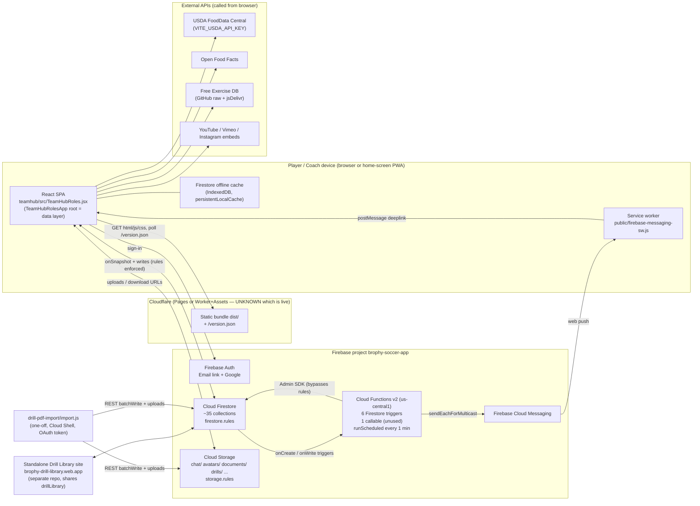

[MEASURED] Each element is cited elsewhere in this document. The Drill Library site is referenced at TH:546 and FR:157-169. Its own code is **not in this repo**: MISSING here, it lives in another repository.

---

## 4. 🗂️ Folder Map

```
brophy-soccer-app/
├── teamhub/                      ← THE LIVE APP (everything that ships)
│   ├── index.html                ← SPA shell, <div id="root">
│   ├── package.json              ← scripts: dev / build / lint / preview (no test)
│   ├── vite.config.js            ← injects __BUILD_ID__, emits /version.json
│   ├── tailwind.config.js, postcss.config.js, eslint.config.js
│   ├── .env.example              ← VITE_USDA_API_KEY, VITE_FIREBASE_VAPID_KEY (names only)
│   ├── firebase.json             ← rules/indexes/storage/functions + a Firebase Hosting block
│   ├── .firebaserc               ← default project brophy-soccer-app
│   ├── firestore.rules           ← 454 lines; team + audience-scoped access
│   ├── firestore.indexes.json    ← 38 composite indexes (some for collections that no longer exist)
│   ├── storage.rules             ← 156 lines; path-scoped uploads, size/type caps
│   ├── cors.json                 ← GET from * on the Storage bucket (line-up canvas)
│   ├── wrangler.toml + worker/index.js ← Cloudflare Worker that only serves dist/ assets
│   ├── functions/
│   │   └── index.js              ← push fan-out triggers + runScheduled (1-min cron)
│   ├── public/
│   │   ├── firebase-messaging-sw.js ← background push + notification click deep-links
│   │   ├── brand/                ← logos, login background
│   │   └── drill-bank.json       ← 600 KB, 783 drills — NOT referenced by any code (dead)
│   └── src/
│       ├── main.jsx              ← React root + ErrorBoundary
│       ├── firebase.js           ← Firebase client init (public web config hard-coded)
│       ├── TeamHubRoles.jsx      ← 9,833 lines: every screen + the root data layer
│       ├── WelcomeTour.jsx       ← first-login tour (role-aware)
│       ├── components/           ← TacticsBoard (2,085 lines), boardData, print sheets, QuoteOfDay, UpdateUI
│       ├── hooks/                ← useAuth, useCollection/useAudienceCollection/useDoc,
│       │                            useFirestoreResync, useAppUpdate
│       ├── lib/                  ← notifications, usda, openfoodfacts, exercises, exerciseSearch,
│       │                            lifting, drillDoc, teamRoles, firestoreHealth, sharePdf, toast, appVersion
│       └── data/                 ← teams.js (team ids), recipeSeed (132), liftSeed (27), workoutSeed (11)
├── drill-pdf-import/             ← one-off pipeline: 35 PDFs → 127 drillLibrary docs (already run 2026-11-18)
├── videos/walkthrough/           ← narrated coach/player walkthrough media (~97 MB, incl. ~90 MB WAV in git)
├── docs/APP_WALKTHROUGH.md       ← this file
├── ANALYSIS.md                   ← 2026-11-08 analysis of the Phoenix app this was cloned from (outdated)
├── TeamHub_Build_Guide.md        ← original generic build guide (outdated: Firebase Hosting, coachcameron.com)
├── TeamHubRoles.jsx              ← STALE 893-line demo prototype at root; imported by nothing
└── guided videos.docx            ← 316 KB Word doc (content not parsed)
```

[MEASURED] Tree from `find`. Counts are from `wc -l`, the sub-agent file reads and `du`.

---

## 5. 🧩 Area-by-Area Walkthrough

### Areas: how they were derived

The areas come from the tab router at TH:9671-9683 and TH:9784-9807, plus the CoachCenter tiles at TH:5014. There is no URL router. Navigation is React state (`tab`) plus optional `?tab=` deep links handled at TH:8760-8785.

| # | Area | Who | Defining code |
|---|---|---|---|
| A1 | Auth, Invite Gate and Onboarding | Everyone | `teamhub/src/hooks/useAuth.js`, TH:392-573 (LoginScreen, NoAccessScreen), TH:8594-8626 (NameGate), `teamhub/src/WelcomeTour.jsx` |
| A2 | Home / Today (wellness, water, quote, docs) | Player "Today" and Coach "Home" | TH:885-1068 (PlayerTodayPage), TH:1091-1547 (HomePage) |
| A3 | Schedule (Calendar, Events, Groups, Reminders) | Everyone (coach edits) | TH:1550-2317 |
| A4 | Coach Center — Practice (Drills, Practices, Programs, Tactics Board) | Coach | TH:2845-4055, `teamhub/src/components/TacticsBoard.jsx` |
| A5 | Coach Center — Game Day line-ups | Coach | TH:4056-4553 |
| A6 | Coach Center — Roster and Invites, Announcements, Documents | Coach | TH:4554-5078, TH:691-861 |
| A7 | Train — Gym (exercise library, workouts) | Everyone (coach edits Team) | TH:7297-8193, `teamhub/src/lib/lifting.js` |
| A8 | Train — Nutrition (recipes, food log, goals) | Everyone | TH:2675-2755, TH:5080-5830 |
| A9 | Train — Videos and Links | Everyone (coach edits) | TH:2320-2674 |
| A10 | Chat (channels, DMs, polls, scheduled posts) | Everyone | TH:5830-7296 |
| A11 | Push Notifications and Scheduler (server) | Coach sends; everyone receives | TH:6276-6448, `teamhub/functions/index.js`, `teamhub/src/lib/notifications.js` |
| A12 | Settings and Org-Admin People and Roles | Everyone; org admin only for roles | TH:8194-8593 |
| A13 | App Shell, Live-Data Recovery and Update Banner | Everyone | TH:9690-9832, `teamhub/src/hooks/useFirestoreResync.js`, `teamhub/src/hooks/useAppUpdate.js` |

---

### A1 — Auth, Invite Gate and Onboarding

#### 🎨 UI LAYER
- **`LoginScreen`** (TH:392-527) [MEASURED]
  - An email field plus **"Email me a sign-in link"** → `sendLink` (TH:399-417). It calls `sendSignInLinkToEmail(auth, email, {url: origin + "/", handleCodeInApp: true})` and stores the email in `localStorage["emailForSignIn"]` (TH:390, TH:411).
  - **"Continue with Google"** → `google()` → `signInWithPopup(auth, new GoogleAuthProvider())` (TH:419-430).
  - States:
    - Busy: "Sending…" (TH:503).
    - Error: an inline red text block (TH:501). Firebase error codes are mapped to friendly copy by `prettyAuthError` (TH:110-123).
    - Link sent: a "Check your email" screen (TH:450-468).
- **Magic-link completion.** A root `useEffect` at TH:8741-8755:
  - If the URL is a sign-in link, it reads the stored email. If that is missing, it falls back to `window.prompt` (TH:8744).
  - It then calls `signInWithEmailLink` and toasts on failure.
- **`NoAccessScreen`** (TH:529-573). Accounts whose role is not `player`, `admin` or `orgAdmin` (today: `drillBuilder`) see a locked screen with a link to the Drill Library site and a Sign out button [MEASURED `teamhub/src/lib/teamRoles.js:14-16`, TH:9650].
- **`NameGate`** (TH:8594-8626). Blocks the app until the user has a first and last name.
  - It triggers when the name is empty, equals the email prefix, or has no space (TH:9654).
  - It writes `users/{uid}.{name, initials}` (TH:8606), then does a full page reload (TH:9655).
- **`WelcomeTour`** (`teamhub/src/WelcomeTour.jsx`). Shown once per device, keyed on `localStorage["teamhub_tour_seen_v1"]` (TH:264, TH:8716-8718). Coach steps are at WT:12 and player steps at WT:24.
  - The player tour includes a face-photo upload step (WT:61-73) that calls `uploadOwnPhoto` (TH:8725-8738).
- **Loading:** a full-screen "Loading…" while `useAuth` resolves (TH:9638-9644).
- **State:** `useAuth` holds `user`, `loading` and `error` (`useAuth.js:46-48`). `previewAsPlayer`, `showTour` and `settingsOpen` live in the root (TH:8698-8702).

#### 🔌 CONNECTION LAYER

| Call | Where | Payload / response | Auth |
|---|---|---|---|
| `onAuthStateChanged` | `useAuth.js:51` | Firebase user or null | — |
| `getDoc(users/{uid})` | `useAuth.js:58` | Profile doc | Signed-in token, sent automatically by the SDK |
| `getDoc(inviteLinks/{code})` | `useAuth.js:74` | `{teamId, expiresAt, maxUses, uses}` | Signed in |
| `getDoc(invitedEmails/{email})` | `useAuth.js:97` | `{role, teamId}` | Signed in |
| `setDoc(users/{uid})` | `useAuth.js:114-121` | `{name, email, role, teamIds:[teamId], primaryTeamId, initials}` | Owner |
| `updateDoc(inviteLinks/{code}, {uses: increment(1)})` | `useAuth.js:128` | — | Signed in |
| `updateDoc(users/{uid}, {teamIds, primaryTeamId})` (legacy backfill) | `useAuth.js:151-157` | — | Owner (rules deny it — see findings) |

The token and session are handled entirely by the Firebase SDK, which persists them in IndexedDB [INFERRED: default Firebase Auth web persistence; there is no `setPersistence` call in `src/`].

#### ⚙️ BACKEND LAYER
There is no server code for auth. All gate logic runs in the browser [MEASURED `useAuth.js:50-176`]. Step by step:
1. Firebase signs the user in. **Any** email address or Google account can authenticate [MEASURED: nothing restricts the providers].
2. If `users/{uid}` already exists → load the profile (`useAuth.js:140-173`).
3. Otherwise, if `?invite=CODE` is in the URL → read `inviteLinks/{code}`. The link is "live" if its `teamId` is valid, it has not expired and its uses are under the cap (`useAuth.js:73-83`). If it is not live → show an error, `signOut`, stop (`useAuth.js:84-95`).
4. Otherwise → read `invitedEmails/{lowercased email}`. If it is missing → "isn't on the team roster", `signOut` (`useAuth.js:97-105`). The role and team come from the invite. A missing or invalid team falls back to `varsity` (`useAuth.js:110-111`).
5. Create the user doc, then bump the link's use count. If the bump fails, only a `console.warn` is logged (`useAuth.js:127-131`).
6. Compute in-memory `teamIds` and `primaryTeamId`, defaulting to `varsity` (`useAuth.js:147-150`). Build `user.sub`, the label shown in the UI (`useAuth.js:170-172`).
7. The root derives `myTeamIds`, where an org admin gets all three teams (TH:8636-8642), and `activeTeamId`, persisted in `localStorage["activeTeamId"]` (TH:8663-8674).
8. Coaches seed `teams/{id}` docs once per session (TH:8680-8697).

- **Validation:** the client checks the email contains `@` (TH:400). The invite link's validity is checked on the client *and* in the rules for the `uses` increment (FR:415-421).
- **Silent fallbacks:**
  - `useAuth.js:154-156` — an empty catch on the team backfill, which keeps using in-memory values.
  - `useAuth.js:111` — a missing or invalid invite team silently becomes `varsity`.
  - `teamhub/src/data/teams.js:17-18` — `getTeam` falls back to Varsity for unknown ids.
  - TH:8693-8695 — team seeding catch with no user feedback.
  - `useAuth.js:51-175` — the async `onAuthStateChanged` callback has **no try/catch**. If `getDoc` throws (offline on first launch, or a permission error), `setLoading(false)` never runs and the user is stuck on "Loading…" forever [INFERRED from code structure].

#### 🗄️ DATA LAYER
- **`users/{uid}`** — `name, email, role ('player'|'admin'|'orgAdmin'|'drillBuilder'), teamIds[], primaryTeamId, initials, photoURL, photoPath, fcmTokens[], notificationsEnabledAt`. Read and written here.
  - Rules (FR:115-135):
    - **Read:** owner, org admin, or anyone sharing a team.
    - **Create:** `isOwner(uid)` with **no field restrictions**.
    - **Update:**
      - The org admin can update anything.
      - A coach on a shared team can update anything except `teamIds/primaryTeamId/role`.
      - The owner can update only `fcmTokens, notificationsEnabledAt, name, initials, photoURL, photoPath`.
    - **Delete:** org admin, or **any coach sharing a team** (including the coach's own doc, and the org admin's doc).
- **`invitedEmails/{email}`** — `email, role, teamId, addedBy, addedAt`. Read only. Rules FR:371-385. Readable by **any member of the team**, so players can list teammates' emails.
- **`inviteLinks/{code}`** — read and incremented here. Rules FR:403-424.
- **`teams/{teamId}`** — `name, shortName, level, coachUids[], wellnessNudgeHour, createdAt`. Created by coaches (FR:102-106). `coachUids` is always `[]` and is never maintained [MEASURED `teamhub/src/data/teams.js:42-48`; nothing else writes it].

#### 🧭 FLOW DIAGRAM
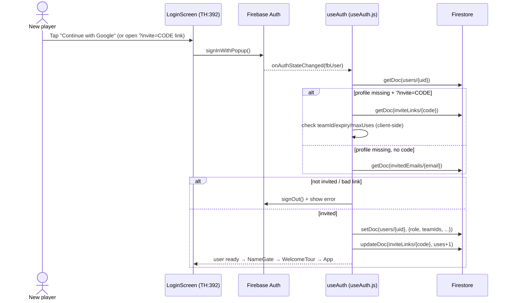

#### ⚠️ AREA FINDINGS
| ID | Sev | Finding |
|---|---|---|
| F01 | 🔴 | **The invite gate runs only in the client, and the `users` create rule is wide open** (FR:117). Anyone with the public Firebase config can sign in with any Google account and `setDoc(users/{theirUid}, {role:"orgAdmin", teamIds:[...]})` → full read and write across all teams, plus the role-management UI. [MEASURED rules; INFERRED exploitability from the rule text.] |
| F02 | 🔴 | **Any team coach can make themselves org admin.** FR:134 lets a coach delete any user doc on a shared team, including their own. FR:117 then lets them re-create it with any role. The same rule also lets a coach delete the org admin's or another coach's profile doc. |
| F03 | 🟠 | Auth callback has no try/catch → infinite "Loading…" on any Firestore error during sign-in (`useAuth.js:51-175`). |
| F04 | 🟡 | The legacy team backfill `updateDoc` is always denied for non-org-admins (FR:128-133 exclude `teamIds`) and silently swallowed (`useAuth.js:152-156`). That is harmless for new users, but a legacy user with no `teamIds` stays invisible to team-scoped server queries such as push (FN:24-26). |
| F05 | 🟡 | Players can read the team's whole invite roster, including emails (FR:372-375). |
| F06 | ⚪ | `window.prompt` fallback for the magic-link email (TH:8744). This is poor UX in in-app browsers. |
| F07 | ⚪ | `NameGate` forces a last name for any single-word name (TH:9654) and reloads the whole page after saving (TH:9655). |
| F08 | ⚪ | `teams/{id}.coachUids` is never populated (`teamhub/src/data/teams.js:46`). The field is dead. |

---

### A2 — Home / Today (wellness, water, quote of the day, documents)

#### 🎨 UI LAYER
- **Player: `PlayerTodayPage`** (TH:885-1068) [MEASURED, sub-agent read]. It shows:
  - A greeting.
  - A face-photo nudge (TH:903) and a "profile update" prompt (TH:960). Dismissal is saved in `localStorage["profilePromptSeen"]` (TH:887-889).
  - A hero card for today's or the next session (TH:968-983).
  - The **wellness check-in**: three 1–5 `Scale` rows for Energy, Soreness and Tiredness, where 1 is worst. Submit stays disabled until all three are set (TH:917, TH:1016).
  - News (announcements).
  - `QuoteOfDay`.
  - Documents to sign (TH:1046).
  - Nutrition progress (TH:1058).
  - A **water** counter. It is +1 only, capped at 8 cups, with no undo (TH:1063).
- **Coach: `HomePage`** (TH:1091-1547). It shows:
  - A "You're running" card for delegated sessions (TH:1482-1520).
  - Dashboard tiles (TH:1462-1477).
  - The **Players readiness list**, sorted Rest → Modified → lowest average (TH:1238-1302).
  - Announcements, read-only (TH:1212-1236).
  - Quote of the Day.
  - **Send notification**, which opens `PushNotificationModal` (TH:1533-1544).
  - Groups management (TH:1330-1407).
  - **Nutrition compliance**, the share of players who logged a meal today (TH:1409-1433).
  - An "Enable notifications" banner for everyone (TH:1105).
- **Readiness verdict** (`readinessFor`, TH:648-662):
  - Any single score of 1 → **Rest**.
  - Otherwise average ≥ 4 → **Ready**.
  - Otherwise average ≥ 2.5 → **Modified**.
  - Below that → **Rest**.
- **Loading state:** **MISSING**. While data loads, empty arrays render as "No check-ins yet today" (TH:1275) and "0/N logged" (TH:1419).
- **Empty states:** present for documents, news, events, check-ins and groups (TH:836, 1025, 1187, 1275, 1359).
- **Errors:** toasts (TH:919, 1135, 1334).

#### 🔌 CONNECTION LAYER (root wiring)

| Operation | Function / query | Shape |
|---|---|---|
| Today's team wellness (coach) | `useCollection("wellnessCheckins", where teamId==active, where date==today)` (TH:9094) | — |
| My wellness today | `useCollection("wellnessCheckins", where uid==me, where date==today)` (TH:9187-9191) | — |
| Submit wellness | `setDoc(wellnessCheckins/{uid}_{today})` (TH:9099-9110) | `{teamId, uid, name, initials, energy, soreness, tiredness, verdict, date, updatedAt}` |
| Water | `useCollection("water", uid==me, date==today)` (TH:9139-9143); `setDoc(water/{uid}_{today}, {uid, date, cups, updatedAt}, merge)` (TH:9145-9151) | — |
| Meal compliance (coach) | `useCollection("mealLogActivity", teamId, date==today)` (TH:9179-9183) | — |
| Quote | `useCollection("quotes", teamId, orderBy createdAt desc)`; `addDoc(quotes, {teamId, text, author, createdByName, createdAt})` (TH:9622-9625) | — |
| Announcements | `useCollection("announcements", teamId, orderBy createdAt desc)` (TH:8800) | — |
| Profile prompt | `appConfig/profilePrompt` (TH:8811-8812) | — |
| Own photo | Storage `avatars/{uid}/{ts}.jpg`, then `updateDoc(users/{uid}, {photoURL, photoPath})` (TH:8725-8738) | — |

`today` is `new Date().toISOString().slice(0,10)`, which is the **UTC** date (TH:9093) [MEASURED].

#### ⚙️ BACKEND LAYER
- **No custom backend for writes.** Rules enforce ownership:
  - `wellnessCheckins`: create and update require `request.resource.data.uid == auth.uid` and team membership (FR:322-326).
  - `water`: requires `uid == auth.uid` (FR:427-430).
- **Cloud Function `onQuoteCreated`** (FN:209-221) pushes each new quote to the team unless `notify === false`.
- **Cloud Function `processWellnessNudges`** runs inside `runScheduled` every minute (FN:605-648):
  - It returns early before 8 AM America/Phoenix.
  - Otherwise it loads every wellness doc for the **UTC** date (FN:610-612) and every user doc (FN:614).
  - For each non-coach player with no wellness doc and no marker, it pushes "Log your wellness" and writes `wellnessNudges/{uid}_{date}` (FN:625-647).
- **Silent fallbacks:**
  - `readinessFor` uses `Number(n)||0`, so missing values count as 0 and drag the verdict toward Rest (TH:654).
  - `VERDICTS[w.verdict] || VERDICTS.Modified` shows unknown data as "Modified" (TH:1277).
  - `addLog` swallows the meal-marker write with `.catch(() => {})` (TH:9123).
  - Group toggle and delete errors are swallowed with `.catch(() => {})` (TH:1339, TH:1394).

#### 🗄️ DATA LAYER
| Collection | Key | Columns used | Rules |
|---|---|---|---|
| `wellnessCheckins` | `{uid}_{YYYY-MM-DD UTC}` | teamId, uid, name, initials, energy, soreness, tiredness, verdict, date, updatedAt | Read: coach of team or owner. Write: owner on own team. Delete: coach (FR:322-326). |
| `wellnessNudges` | `{uid}_{date}` | teamId, uid, date, nudgedAt | Client write denied; coach read (FR:333-336) |
| `water` | `{uid}_{date}` | uid, date, cups, updatedAt | Owner (FR:427-430) |
| `mealLogActivity` | `{uid}_{date}` | teamId, uid, date, lastLoggedAt | Coach read; owner write (FR:435-439) |
| `quotes` | auto | teamId, text, author, createdByName, createdAt, (notify) | Team read; coach write (FR:286-290) |
| `appConfig` | `profilePrompt`, `lineupLogo` | requestedAt, byName / url, path, updatedByName | Any signed-in user reads; **any coach of any team** writes (FR:262) |

#### 🧭 FLOW DIAGRAM
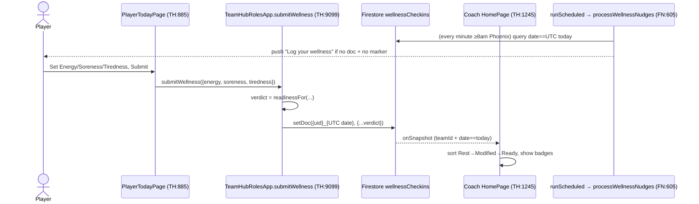

#### ⚠️ AREA FINDINGS
| ID | Sev | Finding |
|---|---|---|
| F09 | 🟠 | **UTC date as "today."** This affects wellness, water and meal markers (TH:9093) and the server nudge (FN:610). After 5 PM in Arizona, check-ins are filed under tomorrow, the coach's evening list goes empty, and the "8 AM" nudge actually fires at about 5 PM the previous day. The marker then suppresses the real morning nudge [INFERRED: Phoenix is UTC−7 with no DST]. The food-log totals use the **local** date instead (TH:9168), so the definitions of "today" are inconsistent. |
| F10 | 🟡 | `wellnessCheckins`, `water` and `mealLogActivity` update rules check only the *new* `uid` field, not the existing one (FR:324, FR:429, FR:437). A signed-in user who knows another player's doc id (`{uid}_{date}`) can overwrite that player's check-in. |
| F11 | 🟡 | No loading states, so "0 logged" and "no check-ins" flash before data arrives (TH:1275, TH:1419). |
| F12 | 🟡 | The dashboard "Meals" tile counts docs, not unique players, and the compliance card divides by an invite count that includes coaches, so the two numbers disagree (TH:1411-1412, TH:1461-1465). The "Readiness" tile shows average energy, not the verdict (TH:1463). |
| F13 | 🟡 | Crash risks: `invites.filter` with no default (TH:1461), `user.name.split` with no guard (TH:1148), `ev.type[0]` when the type is missing (TH:2105). |
| F14 | 🟡 | HomePage's Groups section stores **emails** in `memberUids`, while GroupsModal stores uids (TH:1383 vs TH:1725). `audienceKeysFor` copes with both formats (TH:38), but the data is mixed. |
| F15 | ⚪ | Water can only go up; there is no undo (TH:1063). |
| F16 | ⚪ | The non-admin branch of `HomePage` duplicates PlayerTodayPage and is unreachable (TH:1525-1532 vs TH:9784-9785) [INFERRED]. |
| F17 | 🟡 | Any coach can overwrite `appConfig` docs, including the line-up logo, for all three teams (FR:262). |

---

### A3 — Schedule (Calendar, Events, Groups, Reminders)

#### 🎨 UI LAYER
- **`CalendarPage`** (TH:1883-2317) has Month, Week, Day and List views.
  - The coach can add or edit team events, manage Groups and import CSV (TH:2153-2158).
  - Players can add only private **personal** events (TH:2159, TH:2214).
  - Event cards: `EventCard` (TH:1600). Detail view: `EventDetailModal` (TH:1640), which shows the linked practice's drills and the workout's exercises.
- **`GroupsModal`** (TH:1710-1818) creates groups and toggles members.
- **`EventRemindersEditor`** (TH:1836-1881) uses presets of 15 minutes to 2 days (`LEAD_PRESETS`, TH:1821).
- **Event form fields written** (TH:1938-1970):
  - `title, date, start, end, location, type`
  - `runByUid`, `runByName` (the "run by" coach delegation)
  - `practiceId, workoutId, workoutName, coachNotes`
  - `reminders[{id, type, offsetMin}]`
  - `startAt` (a JS Date, **built in the device's timezone**, TH:1962)
  - `visibleTo{groupIds, uids}` (custom audience only)
- **CSV import** (TH:1550-1590):
  - Columns `date,start,end,title,location,type`.
  - Blank times default to 15:00–17:00 and unknown types become "Practice" (TH:1583-1587).
  - Rows without a valid date or title are dropped silently (TH:1589).
  - Silent import (`notify:false`) is the default (TH:1893).
- **Validation:** title required; end must be after start (TH:1933-1935).
- **States:** empty states exist for week, day and list (TH:2099, 2122, 2136). The Month view has none. There are no loading states.

#### 🔌 CONNECTION LAYER
| Operation | Code |
|---|---|
| Read team events | `useAudienceCollection("events", user, null, activeTeamId)` (TH:8828). Coaches query `teamId==X`. Players query `teamId==X AND audienceKeys array-contains-any ['*','uid:me','email:me']` (`useCollection.js:122-135`). The client then re-filters players' events by `visibleTo` and group membership (TH:8846-8868). |
| Add / update / delete | `addDoc(events, {...data, teamId, audienceKeys, createdAt})` (TH:8874-8880); `updateDoc` with re-computed `audienceKeys` when `visibleTo` changes (TH:8870-8881); `deleteDoc` (TH:8882) |
| CSV / program import | `writeBatch` of `set(doc(events))` rows with `notify:false` (TH:8883-8893) |
| Personal events | `users/{uid}/personalEvents` CRUD (TH:8896-8902) |
| Groups | `addDoc(groups, {teamId, name, memberUids:[], createdBy, createdAt})`. `updateGroupMembers` updates the group, then re-stamps `audienceKeys` on events and chatGroups addressed to it (TH:8905-8934). |

Audience keys are built by `audienceKeysFor(visibleTo, groups)` (TH:39-50):
- An empty audience → `['*']`.
- Otherwise `uid:`/`email:` keys, with groups expanded to their members.
- An audience that resolves to no one → `['uid:__none__']`.

#### ⚙️ BACKEND LAYER
Four Cloud Functions handle events:
- **`onEventCreated`** (FN:223-238). Skips when `notify === false`. Otherwise it resolves `audienceKeys` → FCM tokens via `tokensForAudienceKeys` (FN:173-184), team-scoped, always including that team's coaches, and pushes "📅 {type}: {title}".
- **`onEventDelegated`** (FN:286-301). Pushes to the newly assigned `runByUid` coach, only when the assignment changes.
- **`onEventReminderSync`** (FN:316-376). On *every* event write:
  - Deletes the event's unsent `scheduled` docs.
  - Recreates one per coach reminder, plus two automatic pings: **1 hour before** and **7:00 AM Phoenix on the day**. Duplicates within the same minute are skipped.
  - **Requires `startAt`.** Without it, no reminders are created (FN:324-325).
- **`runScheduled` → `processScheduledItems`** (FN:494-557) then fires them. See A11.

Rules for `events`, `groups` and personal events:
- `events` (FR:143-149): coaches read all team events. Members read only events that are in their audience. Writes require coach of that team, and `teamId` cannot change.
- `groups` (FR:448-452): members read; coaches write.
- `users/{uid}/personalEvents` (FR:442-444): owner only.

Silent fallbacks:
- Event delete has **no confirm** and swallows errors with `.catch(() => {})` (TH:2014-2015).
- CSV defaults to 15:00/17:00 and "Practice" (TH:1583-1587). Editing a legacy event with no times writes those defaults back (TH:1984-1988).
- A custom audience with nothing selected silently saves as Everyone (TH:1963).

#### 🗄️ DATA LAYER
| Collection | Columns | Notes |
|---|---|---|
| `events` | teamId, title, date, start, end, location, type, runByUid, runByName, practiceId, workoutId, workoutName, coachNotes, reminders[], startAt, visibleTo, audienceKeys[], notify, programId, createdAt | Indexes on teamId + start and teamId + audienceKeys (`firestore.indexes.json`) |
| `groups` | teamId, name, memberUids[] (uids **or** emails), createdBy, createdAt | Expanded into `audienceKeys` at write time |
| `users/{uid}/personalEvents` | title, date, start, end, location, type, createdAt | Private |
| `scheduled` (derived reminders) | eventId, teamId, auto, sent, sendAt, type, title, body, visibleTo, reminderId, createdBy* | Written by the function only, for event reminders |

#### 🧭 FLOW DIAGRAM
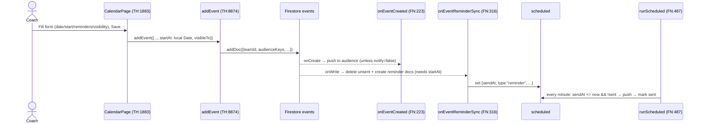

#### ⚠️ AREA FINDINGS
| ID | Sev | Finding |
|---|---|---|
| F18 | 🟠 | **CSV-imported events and program-assigned practices never get reminders.** The rows carry no `startAt` (TH:1580-1589, TH:3922-3930), and `onEventReminderSync` requires it (FN:324-325). They also get no event push, because they are imported with `notify:false` (TH:3933, TH:1893). |
| F19 | 🟠 | `startAt` is built in the **coach's device timezone** (TH:1962), while the auto 7 AM ping is computed in Phoenix time (FN:363-364). A coach whose device is set to another timezone schedules reminders at the wrong time. |
| F20 | 🟠 | Event delete: no confirm, and errors are swallowed (TH:2013-2016). |
| F21 | 🟡 | Switching Team ↔ Personal while editing creates a duplicate instead of moving the event (TH:1939-1970). |
| F22 | 🟡 | `onEventReminderSync` runs on every event write, including edits that don't touch timing, and deletes and recreates the scheduled docs each time (FN:316-376). This races with `runScheduled` and wastes writes [INFERRED]. |
| F23 | ⚪ | CSV import has no time-format or real-date validation, and dropped rows are not reported (TH:1589). |
| F24 | ⚪ | `EventChip` appears unused (TH:1593) [INFERRED]. |

---

### A4 — Coach Center: Practice (Drills, Practices, Programs, Tactics Board)

#### 🎨 UI LAYER
- **`CoachCenterPage`** (TH:5014) shows six tiles: Practice, Game Day, Roster, Calendar, Documents and Announcements. It is shown only when `effUser.role==="admin"` (TH:9796).
- **`PracticePage`** (TH:3969) is the hub, with a "Today" card and section banners.
- **`DrillsPage`** (TH:3017) is the shared drill library with 18 categories (`DRILL_CATS`, TH:306). It supports:
  - Create, edit and delete.
  - "Duplicate for a progression" (TH:3141).
  - Photo uploads.
  - The **TacticsBoard** diagram editor (TH:3270).
- **`DrillModal`** (TH:2893) is a read-only drill card. It has "Play animation" (`BoardPlayer`) and Print (`DrillPrintSheet`, which uses `window.print()`).
- **`PracticeDetail`** (TH:3451) is a block editor. It has:
  - Phases (TH:316, TH:3415) and templates (TH:3416).
  - Target minutes.
  - **Autosave after a 700 ms debounce** (TH:3469-3474).
  - A Publish toggle and delete (with confirm, TH:3485).
  - PDF export via `shareSheetPdf` (`teamhub/src/lib/sharePdf.js`).
- **`ProgramDetail` / `ProgramsView`** (TH:3693, TH:3791) handle ordered days of practices, with autosave (TH:3702-3707).
  - **`AssignProgramModal`** (TH:3910) writes one calendar event per day.
- **`TacticsBoard.jsx`** (2,085 lines):
  - An SVG pitch with tokens, arrows, zones and recorded animation steps.
  - Save exports a 2× PNG plus structured `diagramData` (`TacticsBoard.jsx:1228-1257`).
  - Video export is a local download only (`TacticsBoard.jsx:642-650`).
- **States:** empty states are present (TH:3303, 3534, 3645). There are **no loading states**. The "Saving…" label clears even when the save failed.

#### 🔌 CONNECTION LAYER
| Operation | Code |
|---|---|
| Drills (shared, no teamId) | `useCollection("drillLibrary", orderBy createdAt desc)` → `normalizeDrillDoc` (TH:8978-8979). `addDoc` with `createdByUid/createdByName` (TH:8980-8986). `updateDoc` adds `updatedAt` (TH:8987). `deleteDoc` (TH:8988). |
| Drill images | Storage `drills/{uid}/{ts}-{rand}.png` for board PNGs (TH:3040-3043) and `.jpg` for photos, downscaled to 1600 px (TH:3066-3071) |
| Practices | `useCollection("practices", teamId, orderBy createdAt desc)`. `addDoc({desc, cat, blocks, published, createdBy*, ..., teamId, name})` (TH:8991-9004) |
| Programs | `useCollection("programs", teamId, ...)`. `addDoc({teamId, name, desc, days, published, shared, createdBy*})` (TH:9007-9018) |
| Assign program | `importEvents(rows, {notify:false})` (TH:3933) |

Drill doc shape: `name` (required), `title, kind, cat, tags[], dur, players, equipment, setup{...}, howTo, objectives[], desc, info, videoUrl, photos[], diagram, diagramData{field, tokens, arrows, zones, animation}, diagramImage, scenario, cues[]` [MEASURED `teamhub/src/lib/drillDoc.js:6-44`].

#### ⚙️ BACKEND LAYER
No functions are involved. Rules do the work:
- **`drillLibrary`** (FR:170-177):
  - **Public read (`if true`)**, even signed out.
  - Create requires a coach or `drillBuilder`, `createdByUid == caller` and a non-empty `name`.
  - Update and delete are allowed for **any** coach or drillBuilder, with no ownership check.
- **`practices` / `programs`** (FR:194-203): team members read; the team's coach writes.
- **Storage `drills/{uid}`** (SR:107-113): any signed-in user reads; the owner writes images under 10 MB.
- **`stripUndefined`** (`drillDoc.js:53-63`) guards against Firestore rejecting `undefined` fields.

Silent fallbacks:
- Drill delete swallows errors with `.catch(() => {})` and has no confirm (TH:3153).
- The autosave `onSave` promise has no catch and `setDirty(false)` runs regardless (TH:3471, TH:3476, TH:3704, TH:3709).
- `targetMin || 90` makes the field impossible to clear (TH:3457).
- A failed TacticsBoard PNG export silently saves without an image (`TacticsBoard.jsx:1252`).

#### 🗄️ DATA LAYER
| Collection | Key columns | Rules |
|---|---|---|
| `drillLibrary` | see shape above, plus createdAt, updatedAt, createdByUid | Public read; builders write (FR:170-177) |
| `drillSuggestions` | name, videoUrl, suggestedByUid | Used by the external Drill Library site only (FR:184-193) [INFERRED: no reads in `teamhub/src`] |
| `drills` (legacy) | — | **No rule.** Fails closed. Left unread on purpose (FR:157-162). |
| `practices` | teamId, name, desc, cat, blocks[], published, targetMin, createdBy*, createdAt | Team-scoped |
| `programs` | teamId, name, desc, days[{label, practiceId}], published, shared, createdBy* | Team-scoped |

#### 🧭 FLOW DIAGRAM
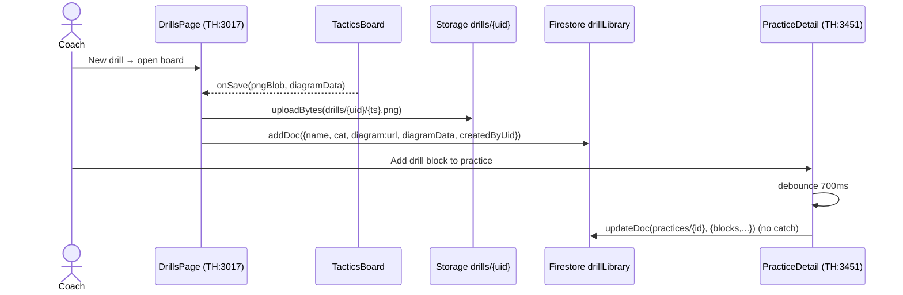

#### ⚠️ AREA FINDINGS
| ID | Sev | Finding |
|---|---|---|
| F25 | 🟠 | Practice and program autosave failures are invisible. There is no `.catch`, and the dirty flag is cleared anyway, so edits can be lost silently (TH:3469-3476, TH:3702-3709). The state is copied from props once, so concurrent edits by two coaches overwrite each other (last write wins). |
| F26 | 🟠 | The "Shared curriculum" toggle can never render. It checks `user?.role === "orgAdmin"` (TH:3772), but the org admin is passed in as `effUser`, whose role is mapped to `"admin"` (TH:9662-9666). |
| F27 | 🟡 | Any coach or drillBuilder can edit or delete **any** drill in the shared library, including drills built in the other app (FR:176). Combined with no-confirm delete (TH:3153), this is a data-loss risk. |
| F28 | 🟡 | `drillLibrary` is world-readable without signing in (FR:171). This is intentional per the comments, but it publicly exposes the content, including PDF links to coach session plans. |
| F29 | 🟡 | `DrillPicker` crashes on a drill that has only `title` (`d.name.toLowerCase()`, TH:3387). It also lists `kind:"point"` items that `DrillsPage` hides. |
| F30 | 🟡 | `PracticePage` "Today" uses the UTC date (TH:3977). After 5 PM Phoenix it shows tomorrow's session. |
| F31 | 🟡 | `DrillPrintSheet` still uses `window.print()`, which the code's own comment says fails in iOS in-app browsers (`sharePdf.js:1-8`; `DrillPrintSheet.jsx:75`). |
| F32 | ⚪ | The `scenario` and `cues` fields are saved but have no inputs, so they are half-built (TH:3019, TH:3126). |
| F33 | ⚪ | Storage objects are never deleted when photos or diagrams are replaced, so orphans accumulate (TH:3086, TH:3232). |

---

### A5 — Coach Center: Game Day line-ups

#### 🎨 UI LAYER
- **`GameDayPage`** (TH:4322-4553) shows a line-up list and editor.
  - Formations: 4-4-2, 4-3-3, 4-2-3-1, 3-5-2, 3-4-3, 5-3-2, 4-5-1 (TH:4056-4064).
  - Tokens are draggable; a tap opens `PlayerPickerSheet` (TH:4282, TH:4402-4413).
  - The picker roster is users plus invited emails that have not signed up (TH:4351-4364).
- **Set player photo** uploads a face photo for any player (TH:4385-4399). **Team logo** sets the line-up watermark (TH:4335-4347).
- **`SendLineupSheet`** (TH:4243) renders an 800×1120 canvas card (TH:4112-4240) and posts it to a chat channel.
- Changing formation **wipes every assigned slot without confirmation** (TH:4368).

#### 🔌 CONNECTION LAYER
| Operation | Code |
|---|---|
| Line-ups | `useCollection("lineups", teamId, orderBy createdAt desc)`. `addDoc({teamId, name, formation, slots[], createdByName, createdAt})` (TH:9021-9031) |
| Player photo | Storage `avatars/{coachUid}/{ts}.jpg`, then `updateDoc(users/{targetUid}, {photoURL, photoPath})` (TH:9034-9035) |
| Team logo | Storage `branding/{uid}/lineup-logo-{ts}.jpg`, then `setDoc(appConfig/lineupLogo, {url, path, updatedByName}, merge)` (TH:8815-8816) |
| Post to chat | `postLineupImage` → Storage `chat/{teamId}/{channel}/{uid}/{ts}.jpg` → `addMessage("Starting XI · name", {attachment})` (TH:9439-9450) |

#### ⚙️ BACKEND LAYER
- `lineups` rules: team read; coach write (FR:205-209).
- A coach editing another user's photo is allowed because coaches may edit non-role fields of users on a shared team (FR:128-130).
- The canvas loads photos with `crossOrigin="anonymous"` (TH:4113-4121). This requires the bucket CORS from `teamhub/cors.json`, applied manually with `gsutil` (`teamhub/README.md:103-114`).
  - **Silent fallback:** without CORS, players render as initials with no warning to the coach (TH:4146-4149).
- The `onMessageCreated` push fires for the posted image (FN:240-259).

#### 🗄️ DATA LAYER
- `lineups` — `teamId, name, formation, slots[{uid|email, x, y, ...}], createdByName, createdAt` [slot shape INFERRED from TH:4402-4413].
- `users.photoURL/photoPath` — written here.
- `appConfig/lineupLogo` — written here.

#### 🧭 FLOW DIAGRAM
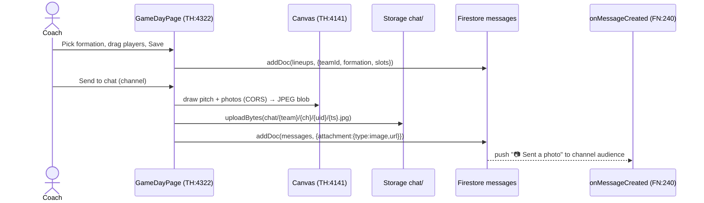

#### ⚠️ AREA FINDINGS
| ID | Sev | Finding |
|---|---|---|
| F34 | 🟡 | A coach can set or replace any player's face photo (minors) with no consent step (TH:4385-4392). The fallback upload path has no size or type check on the client (TH:2814); the Storage rule still caps it at 10 MB (SR:84-90). |
| F35 | 🟡 | Changing formation wipes the line-up with no confirm (TH:4368). |
| F36 | 🟡 | `deleteLineup` has no catch (TH:4473). |
| F37 | ⚪ | The logo is converted to JPEG, so a transparent PNG gets a black background (TH:2756-2771, TH:4339). |

---

### A6 — Coach Center: Roster and Invites, Announcements, Documents

#### 🎨 UI LAYER
- **`RosterInvitesPage`** (TH:4554-4925) provides:
  - Single invite (TH:4598-4607).
  - Bulk paste, split on whitespace, commas and semicolons and regex-validated (TH:4589-4596). Invalid entries are dropped silently, with no count shown.
  - A team picker (TH:4558-4580).
  - **Invite links** with optional expiry date and max uses (TH:4632-4635). The URL is `origin/?invite=CODE`.
  - Link status computed on the client: Active, Expired or Used up (TH:4659-4679).
  - Revoke (TH:4831) — no confirm, and errors are swallowed.
  - Coach ↔ Player role toggle, org admin only (TH:4848-4867).
  - "Ask everyone to update their info" (TH:4699-4703).
  - People who joined by link are listed without remove or role controls (TH:4901-4917).
- **`AnnouncementsPage`** (TH:4927-4996): post, edit, pin and delete. Delete has no confirm and swallows errors (TH:4957).
- **`DocumentsPage` / `DocumentsSection`** (TH:4998, TH:811-861):
  - The coach uploads PDFs, Office files or images (`DOC_ACCEPT`, TH:691-701).
  - The coach sees "N/M signed" and who signed (TH:790-796).
  - The player signs by **typing their name** (TH:799-803).

#### 🔌 CONNECTION LAYER
| Operation | Code |
|---|---|
| Invites | `useCollection("invitedEmails", teamId, orderBy email)` (TH:9234). `setDoc(invitedEmails/{email}, {email, role:"player", teamId, addedBy, addedAt})` (TH:9235-9249). Batch version at TH:9251-9264. `deleteDoc` (TH:9250). |
| Invite links | `setDoc(inviteLinks/{code}, {teamId, createdByUid, createdByName, code, createdAt, expiresAt, maxUses, uses:0})` (TH:9275-9289). The code is 16 chars from `crypto.getRandomValues` (TH:9266-9272). List: `useCollection("inviteLinks", teamId)` (TH:9294). |
| Role change | `setInviteRole` updates the invite, then queries `users where email==` and updates `role` (TH:9302-9313). It is guarded on the client to org admin only. |
| Announcements | `addDoc(announcements, {teamId, title, body, pinned:false, createdAt})` (TH:8801-8808). Update, pin and delete at TH:8822-8826. `requestProfileUpdate` sets `appConfig/profilePrompt` and posts an announcement (TH:8817-8821). |
| Documents | Storage `documents/{teamId}/{uid}/{ts}-{filename}`, then `addDoc(documents, {teamId, title, url, path, name, fileType, createdByName, signatures:[], createdAt})` (TH:9206-9218). Sign: `arrayUnion({uid, name, ts})` (TH:9220-9221). |

#### ⚙️ BACKEND LAYER
- **`onAnnouncementCreated`** (FN:196-206) pushes to every token on the team.
- Rules:
  - `invitedEmails` (FR:371-385): only the org admin can change `role`.
  - `inviteLinks` (FR:403-424): get for any signed-in user; list for coaches; uses can only go up by +1 while live; delete by the org admin or the coach who created the link.
  - `documents` (FR:215-221): members may change only `signatures`.
  - `announcements` (FR:138-142).
- Storage `documents/{teamId}/{uid}` (SR:142-148): any **team member** (including players) may write any file type up to 50 MB.

#### 🗄️ DATA LAYER
- `invitedEmails/{email}` — email, role, teamId, addedBy, addedAt.
- `inviteLinks/{code}` — see above.
- `announcements` — teamId, title, body, pinned, createdAt.
- `documents` — teamId, title, url, path, name, fileType, createdByName, signatures[{uid, name, ts}], createdAt.

#### 🧭 FLOW DIAGRAM
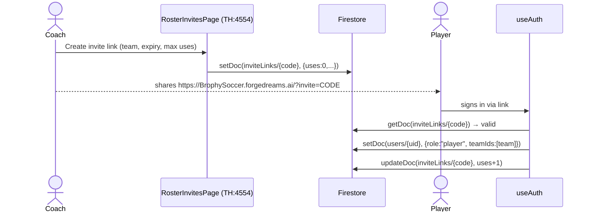

#### ⚠️ AREA FINDINGS
| ID | Sev | Finding |
|---|---|---|
| F38 | 🟡 | **The e-signature is just a typed name** stored in an array on the document (TH:9220-9221). There is no audit trail, no document hash and no identity binding beyond the uid, and a coach can remove signatures, since `coachUpdate` covers every field (FR:219). It is not legally robust [INFERRED]. |
| F39 | 🟡 | Players can upload arbitrary files up to 50 MB into team document storage (SR:142-148). The UI only lets coaches do this, but the rules allow any member. |
| F40 | 🟡 | Any signed-in user who knows a live link code can repeatedly bump `uses` and exhaust the link (FR:415-421). |
| F41 | 🟡 | There is no UI to remove a player who joined by link (TH:4896-4917). Removal requires the Firebase console [INFERRED]. |
| F42 | 🟡 | Revoke-link and announcement delete have no confirm and swallow errors (TH:4831, TH:4957). |
| F43 | ⚪ | Clicking "Post" while editing an announcement can overwrite the announcement being edited, because the edit id is not cleared (TH:4967). |
| F44 | ⚪ | Document links are Storage download URLs that carry their own access token. Anyone with the URL can open them, outside the team rules [INFERRED: standard `getDownloadURL` behaviour; TH:9211]. |

---

### A7 — Train: Gym (Exercise Library, My Workouts, Team Workouts)

#### 🎨 UI LAYER
- **`GymPage`** (TH:7971) has tabs **Library | My Workouts | Team Workouts**. Only coaches can edit Team Workouts (TH:8016).
- **`ExerciseLibrary`** (TH:7410):
  - Browse by equipment, then muscle, then exercise.
  - Fuzzy search via `searchExercises`, with aliases, one-typo tolerance and the top 40 results (`teamhub/src/lib/exerciseSearch.js:87-108`).
  - Coaches get "New exercise" (`CustomExerciseForm`, TH:7314) and the "Prehab starter" seed (TH:7489-7494).
- **`WorkoutsView` / `WorkoutDetail`** (TH:7616, TH:7771):
  - Reorder, supersets and templates (`WORKOUT_TEMPLATES` in `lifting.js`).
  - **Autosave after a 700 ms debounce** (TH:7779-7784).
  - Download as HTML (TH:7738-7769).
- **`ExerciseModal`** (TH:8030): "Add to Workout".
- **States:** the library has loading and error states (TH:7467-7468). Workouts have empty states (TH:7708, TH:7840) but no loading state.

#### 🔌 CONNECTION LAYER
| Operation | Code |
|---|---|
| Public exercise DB | `fetch(raw.githubusercontent.com/yuhonas/free-exercise-db/main/dist/exercises.json)`, cached per page load. Images come from `cdn.jsdelivr.net/gh/...@main` (`teamhub/src/lib/exercises.js:5-35`). |
| Custom exercises | `useCollection("customExercises", orderBy createdAt desc)`. CRUD plus `seedLifts` batch (TH:9039-9054). Photos go to `exercises/{uid}/...jpg` (TH:7328-7332). |
| My workouts | `users/{uid}/workouts`, `{exercises[], name, createdAt, updatedAt}` (TH:9348-9362) |
| Team workouts | `teamWorkouts` with `{exercises[], teamId, name, createdBy*, createdAt, updatedAt}` (TH:9364-9381). `seedTeamWorkouts` (TH:9383-9396). |

#### ⚙️ BACKEND LAYER
- Rules:
  - `customExercises` (FR:210): any signed-in user reads; any coach writes.
  - `users/{uid}/workouts` (FR:357-359): owner only.
  - `teamWorkouts` (FR:362-366): team read; coach write.
- No functions are involved.
- `lifting.js` provides prescriptions (sets/reps, %-of-max, RPE, tempo, supersets) and templates.
  - The %-of-max feature is **half-built**: `formatPrescription` is called without maxes (TH:7897).
  - `detectPRs`, `seedLogSets` and `epley1RM` are never imported, so they are dead code (`lifting.js:91-120, 234-240`).

#### 🗄️ DATA LAYER
- `customExercises` — name, equipment, muscles[], aliases[], level, mechanic, steps, photos[], createdAt.
- `users/{uid}/workouts` — name, exercises[{name, sets, reps, pct, rpe, tempo, superset, ...}], createdAt, updatedAt.
- `teamWorkouts` — the same, plus teamId, area, createdBy*.

#### 🧭 FLOW DIAGRAM
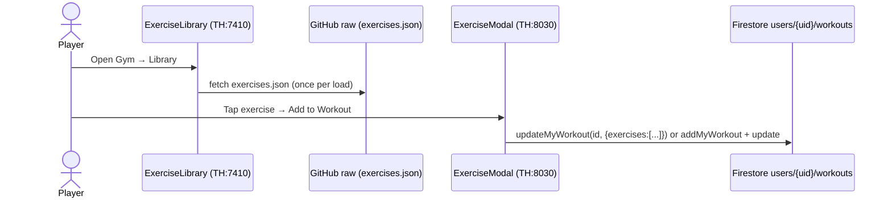

#### ⚠️ AREA FINDINGS
| ID | Sev | Finding |
|---|---|---|
| F45 | 🟠 | Workout autosave has no catch and clears the dirty flag anyway (TH:7781). `WorkoutDetail` has no `key`, so after "Duplicate" it keeps the old workout's local state. The next autosave can then write the original's data over the copy (TH:7656, TH:7772-7773) [INFERRED]. |
| F46 | 🟡 | The exercise library depends at runtime on an **unpinned** GitHub repo `@main` (`exercises.js:5-10`). Its content or availability can change without notice. |
| F47 | 🟡 | %-of-max prescriptions never resolve to real weights, because no maxes are ever loaded (TH:7897) — the feature is half-built. |
| F48 | ⚪ | `seedTeamWorkouts` is passed to `ExerciseLibrary` but never used there (TH:8002). |

---

### A8 — Train: Nutrition (Recipes, Food Log, Goals)

#### 🎨 UI LAYER
- **`NutritionPage`** (TH:5176-5742). It contains:
  - **`NutritionHero`**: calorie and protein against the player's own goal, a logging streak, and water (TH:2675).
  - **`MyNutritionGoalSection`**: an optional personal calorie and protein goal (TH:5106).
  - Meal-category chips: Breakfast, Lunch, Dinner, Snacks, Pre-Game and Post-Game (TH:5080). Food-type sub-chips and a recipe list.
- **"Log" sub-view** (TH:5543). Quick-add from saved and recent foods, plus a manual form with **unified food search**:
  - Searches Open Food Facts and USDA, debounced 300 ms with an abort controller (TH:5236-5265).
  - Results are merged, de-duplicated by name and capped at 16.
  - The manual form has **no carbs or fat inputs** (TH:5631).
- **Barcode** via `BarcodeScannerModal`, using html5-qrcode with the rear camera (TH:5743-5828).
- Rate a meal by "feeling" (TH:5385).
- **Coach "Manage" view** (TH:5463): add or edit recipes, CSV import (`CSV_TEMPLATE`, TH:355) and "Add starter recipes" (132 recipes).
- **States:** search shows "searching…" and an error (TH:5613-5615), and there is a "Nothing logged yet today" empty state (TH:5643). Recipes have no loading state.

#### 🔌 CONNECTION LAYER
| Operation | Code |
|---|---|
| Recipes / categories (shared) | `useCollection("recipes", orderBy createdAt desc)`, `useCollection("categories", orderBy name)`. CRUD, import and seed at TH:9056-9091. |
| Food log | `logs/{uid}/entries`, `{name, cal, p, c, f, feeling, ..., createdAt}`. On every add, also writes `mealLogActivity/{uid}_{today}` (TH:9113-9128). |
| Saved foods | `logs/{uid}/savedFoods` (TH:9131-9136) |
| Goal | `useDoc("logs/{uid}/goals/main")`; `setDoc({cal, protein, updatedAt}, merge)`; `deleteDoc` (TH:9159-9166) |
| USDA | `GET https://api.nal.usda.gov/fdc/v1/foods/search?api_key=VITE_USDA_API_KEY&query=…&pageSize=8` (`usda.js:28-47`) |
| Open Food Facts | `GET world.openfoodfacts.org/cgi/search.pl?...` and `/api/v2/product/{barcode}.json` (`openfoodfacts.js:10-73`) |

#### ⚙️ BACKEND LAYER
- Rules:
  - `recipes` and `categories` (FR:283-284): any signed-in user reads; any coach writes.
  - `logs/{uid}/entries|savedFoods|goals` (FR:339-354): owner only.
  - Coaches see only the `mealLogActivity` markers, never what a player ate (FR:435-439).
- No functions are involved.
- **Silent fallbacks:**
  - Missing nutrients become 0 (`usda.js:13`, `openfoodfacts.js:57-58`, TH:5368-5371).
  - Barcode values are per 100 g but are logged as one serving (TH:5224).
  - The meal-marker write is swallowed (TH:9123).
  - Rate and delete log are swallowed (TH:5385-5386).

#### 🗄️ DATA LAYER
- `recipes` — name, cat, sub, cal, p, c, f, prep, ingredients, createdAt.
- `categories` — name.
- `logs/{uid}/entries` — name, cal, p, c, f, feeling, barcode?, createdAt.
- `logs/{uid}/savedFoods` — name and macros.
- `logs/{uid}/goals/main` — cal, protein, updatedAt.
- `mealLogActivity` — see A2.

#### 🧭 FLOW DIAGRAM
```mermaid
sequenceDiagram
  actor P as Player
  participant N as NutritionPage (TH:5176)
  participant OFF as Open Food Facts
  participant USDA as USDA FDC
  participant FS as Firestore
  P->>N: Type "chicken" in Log form
  par debounce 300ms
    N->>OFF: search.pl
    N->>USDA: foods/search (if key)
  end
  N-->>P: merged results (per 100g)
  P->>N: Pick result → Log
  N->>FS: addDoc(logs/{uid}/entries)
  N->>FS: setDoc(mealLogActivity/{uid}_{UTC date}) (errors swallowed)
```

#### ⚠️ AREA FINDINGS
| ID | Sev | Finding |
|---|---|---|
| F49 | 🟡 | **Recipe form crash after "Cancel Edit."** The reset object omits `sub` (TH:5505), so the next "Add Recipe" throws on `single.sub.trim()` (TH:5396) [MEASURED both lines]. |
| F50 | 🟡 | `VITE_USDA_API_KEY` ships in the public JS bundle and in request URLs (`usda.js:6, 33`). The key is free, but it can be scraped and rate-limited by others. |
| F51 | 🟡 | `mealLogActivity` uses the UTC date while the in-app totals use the local date (TH:9118 vs TH:9168). See F09. |
| F52 | ⚪ | Per-100 g values are logged as a serving with no portion input, and there are no carbs or fat fields in the manual form (TH:5224, TH:5631). |
| F53 | ⚪ | "searching…" can get stuck when the query becomes shorter than 2 characters mid-search (TH:5233-5235). |

---

### A9 — Train: Videos and Links

#### 🎨 UI LAYER
- **`VideosPage`** (TH:2351-2637) has folder pills, including six built-ins (`VIDEO_CATS`, TH:298) plus coach folders and subfolders, and a two-column card grid.
- **`VideoModal`** (TH:2638) embeds YouTube, Vimeo or Instagram via `toEmbedUrl` (TH:126-167). Anything else becomes an external link.
- Coach actions: add, edit, delete, CSV import (`VIDEO_CSV_TEMPLATE`, TH:2320), and folder add, rename and delete.
- Empty state: "Nothing here yet" (TH:2605). There is no loading state.

#### 🔌 CONNECTION LAYER
- `videos`: `useCollection("videos", orderBy createdAt desc)` with CRUD and batch import (TH:8936-8945).
- `videoFolders`: `{name, parent, createdAt}`. Rename re-files the matching videos and subfolders in one batch (TH:8953-8971).

#### ⚙️ BACKEND LAYER
- Rules: `videos` and `videoFolders` are readable by any signed-in user and writable by any coach (FR:151-156). They are shared across teams.
- No functions are involved.
- **Silent fallbacks:**
  - Video delete swallows errors and has no confirm (TH:2495).
  - CSV defaults: blank category → "Film", invalid difficulty → "Easy", invalid type → "video" (TH:2333-2342). Rows without a title or URL are dropped silently.

#### 🗄️ DATA LAYER
- `videos` — title, url, cat, subfolder, dur, diff, desc, type, createdAt.
- `videoFolders` — name, parent (folder *name*, not id), createdAt.

#### 🧭 FLOW DIAGRAM
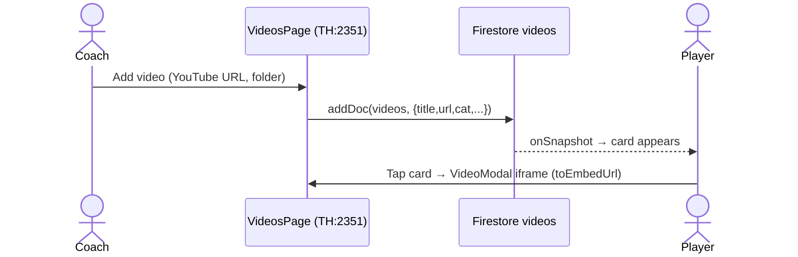

#### ⚠️ AREA FINDINGS
| ID | Sev | Finding |
|---|---|---|
| F54 | 🟡 | Folders are linked by **name**, not id (TH:8960-8971). Two folders with the same name collide, and a partial failure orphans videos. |
| F55 | ⚪ | YouTube `t=1m30s` is parsed as 1 second (TH:134). Iframes have no `sandbox` attribute (TH:2650). |
| F56 | ⚪ | If the video import fails after its new folders have been created, those folders are left behind with no rollback (TH:2465-2480). |

---

### A10 — Chat (Channels, DMs, Polls, Reactions, Scheduled Posts)

#### 🎨 UI LAYER
- **`MessagesPage`** (TH:6498-7296).
  - The inbox (TH:6911) lists the **Team** channel, coach-created channels and Direct messages.
  - A conversation view supports:
    - Replies (TH:9420-9426).
    - Pins (coach only).
    - Polls with 2–4 options; any member can create one (TH:7220, TH:7274).
    - Reactions 👍 👎 ❤️ (TH:5848).
    - Read receipts, "Seen by N" (TH:7177-7181).
    - A "Shared media/links" tab (TH:6977).
    - A fullscreen `VideoViewer` (TH:6484).
  - Coaches also get:
    - `ChannelModal` / `ChannelRow` to create channels, set the audience with `AudiencePicker` and edit members (TH:5900-6060).
    - `ScheduledModal` for scheduled reminders and polls, with repeats (TH:6082-6275).
- **Attachments:**
  - Images are downscaled to 1600 px JPEG (TH:6597-6637).
  - Videos are capped at 100 MB (TH:6647-6670).
  - Files (pdf/doc/xls/ppt/txt/csv/rtf) are capped at 25 MB (TH:6673-6690).
- **DMs.** Only between a player and **their own team's coach(es)**. The org admin is excluded.
  - The thread id is the player's uid (TH:6585-6588).
  - A coach cannot start a DM; they only see threads a player has opened (TH:6574-6576).
- **Unread badge** on the Chat tab (TH:9630-9634).
- **States:** empty states exist for DMs and the shared tab. A channel with no messages shows a blank feed. There is no loading state, and uploads show a spinner with no progress bar.

#### 🔌 CONNECTION LAYER
| Operation | Code |
|---|---|
| Messages | `useAudienceCollection("messages", user, "createdAt", activeTeamId)` (TH:9399). **No limit.** |
| Post | `addDoc(messages, {senderUid, sender, initials, text, pinned, channel, teamId, audienceKeys (copied from the channel), isCoach, readBy, createdAt, attachment?, replyTo*?, kind/question/options/votes?})` (TH:9400-9435) |
| Read / vote / react | `updateDoc` on `readBy.{uid}` (batched; **no 500-op chunking**, TH:9454-9462), `votes.{uid}` (TH:9464-9467) and `reactions.{uid}` (TH:9469-9472) |
| Channels | `useAudienceCollection("chatGroups", …)`. `addDoc({teamId, name, visibleTo, audienceKeys, createdByName, createdAt})`. `updateChatGroup` re-stamps every loaded message in the channel in batches of 400, then the channel itself (TH:9476-9503). |
| DMs | `useCollection("dms", teamId [, threadId==me])` (TH:9588-9592). `addDoc(dms, {teamId, threadId, senderUid, senderName, isCoach, text, readBy, createdAt, attachment?})` (TH:9593-9607) |
| Scheduled | `addDoc(scheduled, {type:'reminder'|'poll', title/body or question/options/channel, visibleTo, sendAt, repeat, repeatDays, tz, teamId, sent:false, createdBy*})` (TH:9507-9518, TH:6107-6146) |
| Attachments | Storage `chat/{teamId}/{channel}/{uid}/{ts}.{ext}`. For DMs the channel is `coach-dm` or `dm:{playerUid}` (TH:6620). |

#### ⚙️ BACKEND LAYER
- **Rules for `messages`** (FR:296-318):
  - **Read:** the team's coach, or a member in the message's `audienceKeys`.
  - **Create:** players are checked by `canPostAsPlayer` (FR:83-97): the channel's audience must include them, the message's keys must be a subset of the channel's, and they cannot set `isCoach`.
  - **Update:** members may change only `readBy`, `votes` or `reactions`, and only while still in the audience.
  - **Delete:** the coach.
- **`chatGroups`** (FR:232-241): an edit that touches the audience must leave a non-empty `audienceKeys`.
- **`dms`** (FR:250-259): the player can access only their own thread. Per-team coaches (not the org admin) can access all threads.
- **Storage `chat/...`** (SR:50-65): team membership is required, plus the channel audience for reads. Uploads are capped at image 10 MB, video 100 MB and documents 25 MB, with an allow-list of MIME types.
- **`onMessageCreated`** (FN:240-259) pushes to the message's `audienceKeys`, excluding the sender. **`onDMCreated`** (FN:264-282) pushes to the thread owner and the team's coaches only.
- **Client backfill.** A one-time pass stamps `audienceKeys` onto legacy events, channels and messages when a coach loads the app (TH:9552-9581).
- **Silent fallbacks:**
  - Pin and delete swallow errors (TH:6793-6794).
  - Read-receipt failures only un-mark the ids locally (TH:6733, TH:6750).
  - `reactToMessage` has no catch (TH:7190).
  - Unknown users display as "Member" (TH:6513).

#### 🗄️ DATA LAYER
- `messages` — see the post payload above. `readBy`, `votes` and `reactions` are maps keyed by uid **on the message doc**.
- `chatGroups` — teamId, name, visibleTo{groupIds, uids|emails}, audienceKeys[], pinned, createdByName, createdAt.
- `dms` — teamId, threadId, senderUid, senderName, isCoach, text, readBy, attachment, createdAt.
- `scheduled` — see above.

#### 🧭 FLOW DIAGRAM
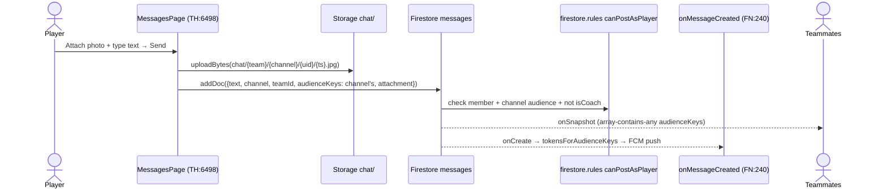

#### ⚠️ AREA FINDINGS
| ID | Sev | Finding |
|---|---|---|
| F57 | 🟠 | **Changing a Group's membership does not re-stamp the messages** in channels addressed to that group. `updateGroupMembers` updates only events and chatGroups (TH:8913-8934), whereas `updateChatGroup` *does* re-stamp messages (TH:9494-9503). As a result, removed members keep reading the old messages and new members cannot see the history. |
| F58 | 🟠 | **There is no pagination or limit** on messages or DMs (TH:9399, TH:9588), and every message is rendered with no virtualization (TH:7109). Load time, memory and Firestore reads grow with every message ever sent. |
| F59 | 🟠 | `markMessagesRead` writes every unread id in a single batch (TH:9454-9462), and a batch is capped at 500 writes. A new member opening a busy channel gets a commit that always fails silently (TH:6733), so the unread badge never clears. |
| F60 | 🟡 | Chat and DM attachments are served through tokenized download URLs (TH:6623). Once a URL is shared, anyone with it can open hidden-channel or DM files, and the Storage audience rule does not apply. For DM paths, the rule looks up `chatGroups/coach-dm` or `chatGroups/dm:x`, which do not exist, so a player cannot read their own DM file through the SDK. In practice only the URL works [INFERRED SR:53-55]. |
| F61 | 🟡 | Coaches cannot start a DM with a player (TH:6574-6576). This looks half-built. |
| F62 | 🟡 | Poll votes, read receipts and reactions sit on the message doc as maps keyed by uid (TH:9465-9471). Every reader can see who voted for what. |
| F63 | ⚪ | `isCoach` is set from the real `user.role === "admin"` (TH:9415, TH:9599), so the org admin's posts are not styled as coach posts. |
| F64 | ⚪ | Chat files with an empty MIME type fall back to `application/octet-stream`, which `storage.rules:64` rejects, so the upload fails (TH:6681). |
| F65 | ⚪ | Poll option limits are inconsistent: 4 in chat versus 6 when scheduled (TH:7220 vs TH:6204). |

---

### A11 — Push Notifications and Scheduler (server)

#### 🎨 UI LAYER
- **Opt-in.**
  - Home banner → `enablePushNotifications(uid)` (TH:1105).
  - Settings toggle → `enablePushNotifications` / `clearAllPushTokens` (TH:8256-8259). The Settings modal also shows iOS "Add to Home Screen" instructions (TH:8519-8530).
- **`PushNotificationModal`** (TH:6276-6448), coach only. It offers:
  - Title and body.
  - An audience: everyone, or selected groups and players.
  - **Send now**, or **Schedule** once or repeating (daily, weekly, or custom days at HH:MM) in the coach's timezone.
  - A history list with delete.
- **Foreground pushes** are shown as an OS `Notification` from the root (TH:8789-8797).
- **Notification click** focuses the app and posts a deep link; the root routes `?tab=` (`firebase-messaging-sw.js:33-47`, TH:8760-8785).

#### 🔌 CONNECTION LAYER
| Operation | Code |
|---|---|
| Register token | `Notification.requestPermission`, then `serviceWorker.register('/firebase-messaging-sw.js')`, then `getToken(messaging, {vapidKey: VITE_FIREBASE_VAPID_KEY})`, then `updateDoc(users/{uid}, {fcmTokens: arrayUnion(token), notificationsEnabledAt})` (`notifications.js:28-54`) |
| Turn off | `updateDoc(users/{uid}, {fcmTokens: []})`, which wipes **all devices** (`notifications.js:66-68`) |
| Send now | `addDoc(pushNotifications, {title, body, audienceKeys, visibleTo, sendAt: serverTimestamp(), recurrence:{type:'none'}, tz, teamId, status:'scheduled', createdBy*})` (TH:9526-9543). It no longer calls the callable — the comment says an org policy blocks it (TH:9536-9539). |
| Schedule | The same, with a future `sendAt` and `recurrence{type, time, days}` |

#### ⚙️ BACKEND LAYER (`teamhub/functions/index.js`, region us-central1, maxInstances 10, FN:13)

| Function | Trigger | What it does |
|---|---|---|
| `onAnnouncementCreated` | `announcements/{id}` create | Push to all team tokens (FN:196-206) |
| `onQuoteCreated` | `quotes/{id}` create | Push the quote unless `notify===false` (FN:209-221) |
| `onEventCreated` | `events/{id}` create | Push to the event audience unless `notify===false` (FN:223-238) |
| `onMessageCreated` | `messages/{id}` create | Push to the message audience, excluding the sender (FN:240-259) |
| `onDMCreated` | `dms/{id}` create | Push to the thread owner and the team's coaches (FN:264-282) |
| `onEventDelegated` | `events/{id}` write | Push to the newly assigned `runByUid` (FN:286-301) |
| `onEventReminderSync` | `events/{id}` write | Rebuild the `scheduled` reminder docs (FN:316-376) |
| `sendPushNotification` | `onCall` | Coach-checked immediate push. **Unused** by the client (FN:386-422; TH:9536) |
| `runScheduled` | `onSchedule("every 1 minutes")` | `processScheduledItems` → `processPushNotifications` → `processWellnessNudges` (FN:487-492) |

Helpers:
- **Token resolution:**
  - `collectTokens` queries `users` where `teamIds array-contains teamId`. **With no teamId it falls back to every user** (FN:23-44).
  - `tokensForAudienceKeys` resolves `uid:` and `email:` keys and always adds the team's coaches (FN:173-184).
  - `tokensForAudience` resolves `visibleTo` for scheduled reminders and loads **all users** when emails or groups are involved (FN:145-162).
- **Sending:** `sendEachForMulticast`, then pruning of invalid tokens (FN:46-92). There is no chunking; FCM multicast is capped at 500 tokens [INFERRED from the FCM documentation; fine at roster scale].
- **Recurrence** is timezone-aware, with two-pass DST settling (FN:440-480). The default timezone is America/Phoenix.
- **Error handling:** each item's `try/catch` logs and continues (FN:553-555, FN:590-592, FN:643-645). A failed item is retried the next minute, because `sent` is not set [INFERRED]. That can repeat forever with no alerting.

#### 🗄️ DATA LAYER
- `pushNotifications` — teamId, title, body, audienceKeys, visibleTo, sendAt, recurrence{type, time, days}, tz, status ('scheduled'|'sent'), sentAt, lastSentAt, createdBy*. Rules FR:277-281.
- `scheduled` — see A3/A10. Rules FR:266-270, coach only.
- `users.fcmTokens[]` — read by the functions.
- `wellnessNudges` — function-only.

#### 🧭 FLOW DIAGRAM
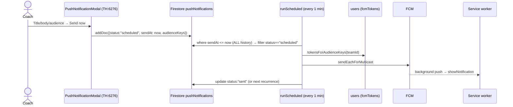

#### ⚠️ AREA FINDINGS
| ID | Sev | Finding |
|---|---|---|
| F66 | 🟠 | **The scheduler cost grows without bound.** Every minute, `scheduled` and `pushNotifications` are queried with `sendAt <= now`, which returns *every historical doc*, and then filtered in JS (FN:497-498, FN:566-567). `processWellnessNudges` reads all users plus a marker doc per un-logged player every minute from 8 AM onward (FN:611-631). That is about 1,440 runs per day [INFERRED read volume]. Fix by querying `where sent==false` / `status=="scheduled"` with a composite index. |
| F67 | 🟠 | Wellness nudge timing bug, as in F09 (FN:610). |
| F68 | 🟡 | "Send now" goes through the 1-minute sweep. The callable `sendPushNotification` is dead code, and its comment says an org policy blocks it (FN:386-422; TH:9536-9539). [UNKNOWN — Batman to confirm which org policy and whether the callable should be removed.] |
| F69 | 🟡 | Turning push "Off" on one device clears the tokens of **every** device (`notifications.js:66-68`). The toggle shows "On" whenever browser permission is granted, not when a token is actually stored (TH:8221). |
| F70 | 🟡 | `collectTokens` with no teamId and `adminUids` fall back to **all users** or the `admin` role across every team, which would leak legacy docs that have no team (FN:24-26, FN:128). |
| F71 | 🟡 | A poisoned scheduled item (one that throws every time) is retried every minute forever and only logged (FN:553-555). There is no dead-letter or retry cap. |
| F72 | ⚪ | Scheduled reminders do not include coaches unless the audience is "everyone" (`tokensForAudience`, FN:145-162), unlike `tokensForAudienceKeys`. The behaviour is inconsistent. |

---

### A12 — Settings and Org-Admin People and Roles

#### 🎨 UI LAYER
- **`SettingsModal`** (TH:8196-8593) contains:
  - **Profile:** photo upload (TH:8204-8215) and name edit (TH:8239).
  - **Team & Role:** read-only (TH:8378-8392).
  - **People & Roles,** org admin only (TH:8396-8513): search users, then set Player, Team Coach or Org Admin and their teams. Editing yourself is blocked (TH:8440).
  - **Notifications:** an on/off toggle and iOS install help (TH:8519-8554).
  - **Help:** replay the tour (TH:8560).
  - **About:** `BUILD_ID` (TH:8576).
  - **Sign out** (TH:8583).
- **"View as player"** (the eye icon, coaches only) sets `previewAsPlayer` (TH:592-596, TH:9662-9666).
- **`TeamSwitcher`** for multi-team users (TH:622-633, TH:9772).

#### 🔌 CONNECTION LAYER
- `orgUsers`: `useCollection("users", orderBy name)`, subscribed only for the org admin (TH:8842-8845).
- `setUserRoleAndTeams` → `updateDoc(users/{uid}, {role, teamIds, primaryTeamId})`, then a best-effort `setDoc(invitedEmails/{email}, {role}, merge)` whose errors are swallowed (TH:9322-9345).
- Photo: Storage `avatars/{uid}/{ts}.jpg` → `updateDoc(users/{uid}, {photoURL, photoPath})` (TH:8209-8211).

#### ⚙️ BACKEND LAYER
- The client guard is `user.role !== "orgAdmin"` → throw (TH:9323-9325).
- The server side is enforced by FR:128-130, where only the org admin may change `role`, `teamIds` or `primaryTeamId`, **but see F01/F02**: a user can bypass this by creating their own doc.
- Silent fallbacks: the invite-sync catch (TH:9343); signOut has no catch (TH:8583).

#### 🗄️ DATA LAYER
`users` (A1) and `invitedEmails` (A6).

#### 🧭 FLOW DIAGRAM
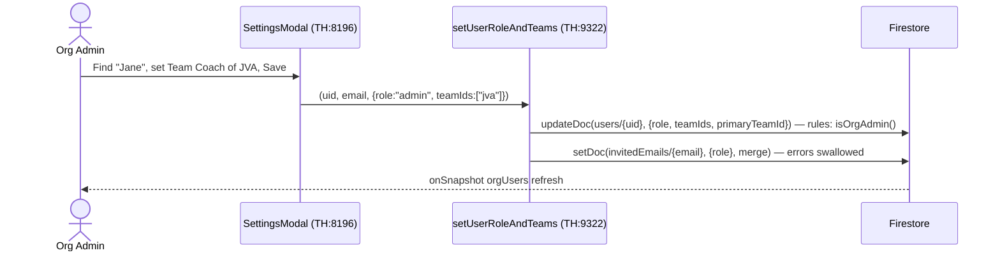

#### ⚠️ AREA FINDINGS
| ID | Sev | Finding |
|---|---|---|
| F73 | 🟡 | `user` loads once at sign-in (`useAuth.js:160-173`; there is no live listener on `users/{uid}`). A role, team or name change does not take effect until reload. The Settings modal shows a stale name or photo. |
| F74 | ⚪ | An org admin saving an org-admin user with no teams can write `primaryTeamId: undefined`, which Firestore rejects (TH:8306, TH:8498) [INFERRED]. |
| F75 | ⚪ | The role buttons have `disabled:` styles but are never disabled (TH:8458). |

---

### A13 — App Shell, Live-Data Recovery and Update Banner

#### 🎨 UI LAYER
- **Layout.** A fixed-inset shell. Phones use a bottom tab bar; laptops (`lg`) get a left sidebar (TH:9690-9832).
  - Coach tabs: Home, Coach, Schedule, Train, Chat (TH:9671-9677).
  - Player tabs: Today, Train, Schedule, Chat (TH:9678-9683).
  - Header (TH:582-620): a "Reconnecting…" chip when the data stream is stale, a manual Refresh button, "View as player" and the avatar.
- **`UpdateBanner`** — "A new version is available → Refresh" (`components/UpdateUI.jsx`).
- **`ErrorBoundary`** — a full-screen "Something went wrong / Reload" (`teamhub/src/main.jsx:10-67`).
- **`Toaster`** — global toasts (TH:268-291, `lib/toast.js`).

#### 🔌 CONNECTION LAYER
- `useAppUpdate` polls `GET /version.json?ts=…` with `cache:no-store` every 5 minutes and on focus, and compares the result with `__BUILD_ID__` (`useAppUpdate.js:11-44`; `vite.config.js:6-15`).
- `useFirestoreResync` (`useFirestoreResync.js:36-126`) handles live-data recovery:
  - **When it fires:** on return to the foreground after more than 30 s away, only if the stream is stale; or when the device comes back online; or when the watchdog sees cache-only snapshots for more than 30 s, with exponential back-off from 60 s up to 10 minutes.
  - **What it does:** `disableNetwork` → `enableNetwork` → `requestFullResync()`, which bumps a generation counter so every `onSnapshot` re-subscribes (`firestoreHealth.js:50-65`).
- `useListenerRetry` retries listeners that failed with `unauthenticated` or `unavailable` at 1/5/15/30/60 s, indefinitely (`useCollection.js:39-65`).

#### ⚙️ BACKEND LAYER
None. This area is client only. Firestore persistence uses `persistentLocalCache` with multi-tab support, and falls back to the default cache if that fails (`firebase.js:23-32`).

#### 🗄️ DATA LAYER
- Local only: the IndexedDB Firestore cache.
- `localStorage` keys: `activeTeamId`, `teamhub_tour_seen_v1`, `emailForSignIn`, `profilePromptSeen` (TH:8665, TH:264, TH:390, TH:889).

#### 🧭 FLOW DIAGRAM
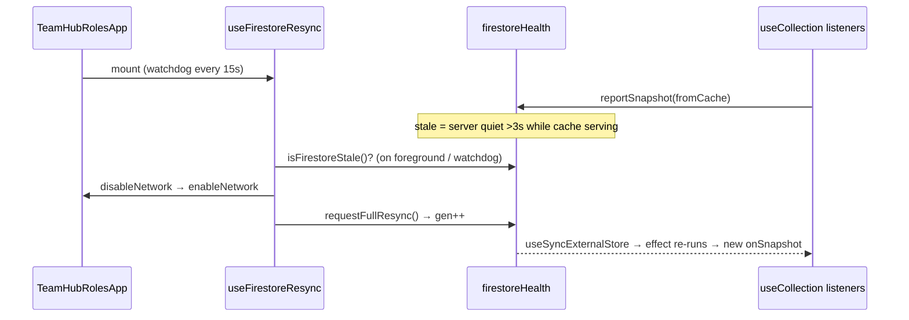

#### ⚠️ AREA FINDINGS
| ID | Sev | Finding |
|---|---|---|
| F76 | 🟡 | `useCollection` swallows **permission-denied** errors with only a `console.warn` (`useCollection.js:57-58, 84-92`). A rules regression shows up to users as empty lists, not as errors. |
| F77 | 🟡 | A full resync re-downloads every unbounded query (F58). It is mitigated by the staleness gating added in commit `9da167a`. |
| F78 | ⚪ | Every user downloads the whole 9.8k-line bundle, including coach-only screens. There is no code-splitting [INFERRED: no `React.lazy` or dynamic `import()` in `src/`]. |

---

## 6. 🔐 Auth Flow (system-wide)

1. **Sign-up / first sign-in.** Authentication is by email magic link (TH:404-417) or Google popup (TH:419-430). Any account authenticates.
   - `useAuth` then enforces the invite gate **in the browser**: an invite link, or an `invitedEmails` doc. Otherwise it signs the user out (`useAuth.js:64-112`).
   - On success it creates `users/{uid}` with the role and team from the invite (`useAuth.js:114-121`).
2. **Profile completion.** `NameGate` requires a first and last name (TH:9653-9655). `WelcomeTour` runs once per device (TH:8716).
3. **Role resolution.**
   - Client: `user.role` comes from the profile doc. `orgAdmin` is shown the coach UI and gets all three teams (TH:8636-8642, TH:9662-9666). Roles outside the three team roles see `NoAccessScreen` (TH:9650).
   - Server: every rule re-reads `users/{request.auth.uid}` through `me()` (FR:24-36) and Storage does the same (SR:17-23). Roles are **not** custom claims [MEASURED: no `setCustomUserClaims` anywhere].
4. **Session.** Firebase Auth persists the session in the browser and refreshes ID tokens automatically, roughly hourly [INFERRED: SDK default; no custom handling]. The Firestore SDK attaches tokens to every request. Listeners that fail with `unauthenticated` are retried (`useCollection.js:37`).
5. **Team context.** `activeTeamId` is stored in `localStorage` and validated against `myTeamIds` during render (TH:8663-8674). Every team-scoped query filters by it, and every write stamps it.
6. **Sign-out.** `signOut(auth)` from Settings (TH:9773), NameGate (TH:8621) or NoAccessScreen (TH:565). FCM tokens are **not** removed on sign-out [INFERRED: no token cleanup in the sign-out paths], so a shared device keeps receiving the previous user's pushes until FCM rotates the token.
7. **Known weaknesses.** F01 and F02 (rules allow self-creation with any role), F03 (stuck loading), F73 (role changes need a reload).

---

## 7. 🗄️ Database Schema (Cloud Firestore)

Firestore is schemaless; the shapes below come from the writes in code. "Team" means the collection carries a `teamId` and access is scoped to members of that team.

| Collection / path | Scope | Key fields | Written by | Rules |
|---|---|---|---|---|
| `users/{uid}` | Profile | name, email, role, teamIds[], primaryTeamId, initials, photoURL, photoPath, fcmTokens[], notificationsEnabledAt | useAuth, NameGate, Settings, org admin, functions (token prune) | FR:115-135 |
| `users/{uid}/workouts/{id}` | Private | name, exercises[], createdAt, updatedAt | Owner | FR:357-359 |
| `users/{uid}/personalEvents/{id}` | Private | title, date, start, end, location, type | Owner | FR:442-444 |
| `teams/{teamId}` | Team | name, shortName, level, coachUids[], wellnessNudgeHour, createdAt | Coach seed | FR:102-106 |
| `invitedEmails/{email}` | Team | email, role, teamId, addedBy, addedAt | Coach | FR:371-385 |
| `inviteLinks/{code}` | Team | teamId, createdByUid, createdByName, code, createdAt, expiresAt, maxUses, uses | Coach; redeemer increments | FR:403-424 |
| `announcements` | Team | teamId, title, body, pinned, createdAt | Coach | FR:138-142 |
| `events` | Team + audience | see A3 | Coach | FR:143-149 |
| `groups` | Team | teamId, name, memberUids[], createdBy, createdAt | Coach | FR:448-452 |
| `practices` | Team | teamId, name, desc, cat, blocks[], published, targetMin, createdBy* | Coach | FR:194-198 |
| `programs` | Team | teamId, name, desc, days[], published, shared, createdBy* | Coach | FR:199-203 |
| `lineups` | Team | teamId, name, formation, slots[], createdByName, createdAt | Coach | FR:205-209 |
| `documents` | Team | teamId, title, url, path, name, fileType, createdByName, signatures[], createdAt | Coach; members sign | FR:215-221 |
| `chatGroups` | Team + audience | teamId, name, visibleTo, audienceKeys[], pinned, createdByName | Coach | FR:232-241 |
| `messages` | Team + audience | see A10 | Members, function (scheduled polls) | FR:296-318 |
| `dms` | Team + thread | teamId, threadId, senderUid, senderName, isCoach, text, readBy, attachment | Player and team coach | FR:250-259 |
| `scheduled` | Team, coach | type, title, body, question, options, channel, visibleTo, sendAt, repeat, repeatDays, tz, sent, eventId, auto | Coach, function | FR:266-270 |
| `pushNotifications` | Team + audience | title, body, audienceKeys, visibleTo, sendAt, recurrence, tz, status | Coach, function | FR:277-281 |
| `quotes` | Team | teamId, text, author, createdByName, createdAt | Coach | FR:286-290 |
| `teamWorkouts` | Team | teamId, name, exercises[], area, createdBy* | Coach | FR:362-366 |
| `wellnessCheckins/{uid}_{date}` | Team | see A2 | Player | FR:322-326 |
| `wellnessNudges/{uid}_{date}` | Team | teamId, uid, date, nudgedAt | Function only | FR:333-336 |
| `mealLogActivity/{uid}_{date}` | Team | teamId, uid, date, lastLoggedAt | Player | FR:435-439 |
| `water/{uid}_{date}` | Private | uid, date, cups, updatedAt | Player | FR:427-430 |
| `logs/{uid}/entries`, `/savedFoods`, `/goals/main` | Private | food log, favourites, goal | Player | FR:339-354 |
| `videos`, `videoFolders` | Shared (all teams) | see A9 | Any coach | FR:151-156 |
| `drillLibrary` | **Public** | see A4 | Coach, drillBuilder, Drill Library site, import script | FR:170-177 |
| `drillSuggestions` | Shared | name, videoUrl, suggestedByUid | Drill Library site | FR:184-193 |
| `customExercises` | Shared | see A7 | Any coach | FR:210 |
| `recipes`, `categories` | Shared | see A8 | Any coach | FR:283-284 |
| `appConfig/{profilePrompt, lineupLogo}` | Global | see A2 | Any coach | FR:262 |
| `drills` (legacy) | — | — | Nobody (no rule → denied) | FR:157-162 |

- **Relationships.** Firestore has no foreign keys. These links are kept by convention only, with no referential integrity:
  - `events.practiceId` → `practices`
  - `events.workoutId` → `teamWorkouts`
  - `programs.days[].practiceId` → `practices`
  - `practices.blocks[].drillId` → `drillLibrary` [INFERRED from TH:3486]
  - `messages.channel` → `chatGroups` id or `"team"`
  - `dms.threadId` → `users` uid
  - `scheduled.eventId` → `events`
- **Composite indexes.** `teamhub/firestore.indexes.json` defines 38. Some reference collections or fields that no code uses: `nutritionTargets`, `attendance`, `attendanceReasons`, `scheduled.runAt`, `users.firstName` [MEASURED by grep: no matches in `src/` or `functions/`]. These are dead indexes left over from the cloned app [INFERRED].
- **Migrations.** **MISSING.** There is no migration framework or ordered migrations folder. Schema evolution happens through:
  1. A client-side `audienceKeys` backfill run by coaches (TH:9552-9581).
  2. A `useAuth` team backfill, which the rules deny (`useAuth.js:151-157`).
  3. A `drills` → `drillLibrary` migration script in the separate Drill Library repo (FR:157-162; `teamhub/src/lib/drillDoc.js:45-49`). It is MISSING from this repo.
  4. The one-off `drill-pdf-import/import.js`, which wrote 127 docs to production on 2026-11-18 (`drill-pdf-import/import-results.json`).

**Storage paths** (`teamhub/storage.rules`):

| Path | Purpose and limits |
|---|---|
| `chat/{teamId}/{channel}/{uid}/{file}` | Chat attachments; team and audience gated; image 10 MB / video 100 MB / docs 25 MB (SR:50-65) |
| `chat/{channel}/{uid}/{file}`, `chat/{uid}/{file}` | Legacy; any signed-in user can read (SR:70-75) |
| `avatars/{uid}/{file}` | Profile photos; readable by teammates; images up to 10 MB (SR:84-90) |
| `branding/{uid}/{file}` | Line-up logo (SR:95-101) |
| `drills/{uid}/{file}` | Drill images, 10 MB (SR:107-113) |
| `drillPdfs/{uid}/{file}` | Session PDFs, 50 MB (SR:119-125) |
| `exercises/{uid}/{file}` | Exercise photos (SR:129-135) |
| `documents/{teamId}/{uid}/{file}` | Team documents; any member can write, 50 MB, any type (SR:142-148) |
| `documents/{uid}/{file}` | Legacy; any signed-in user can read (SR:152-154) |

Every user-folder path above (`drills`, `drillPdfs`, `exercises`, `branding`) can be written by **any authenticated account**, including uninvited Google accounts, into its own folder. That allows storage abuse (F79).

---

## 8. 🌱 Environment Variables

| NAME | Used in (file) | Purpose | Required? |
|---|---|---|---|
| `VITE_USDA_API_KEY` | `teamhub/src/lib/usda.js:6` | USDA FoodData Central food search. **Baked into the public bundle.** | Optional. Without it, food search uses Open Food Facts only (`usda.js:26`, `teamhub/README.md:44`). |
| `VITE_FIREBASE_VAPID_KEY` | `teamhub/src/lib/notifications.js:15` | Web Push VAPID public key for FCM `getToken` | Required for push. Without it, enabling push throws (`notifications.js:30`). |
| `CF_PAGES_COMMIT_SHA` | `teamhub/vite.config.js:7` | Build id for `/version.json` and the update banner. Set automatically by Cloudflare Pages. | Optional; falls back to `Date.now()`. |

Values that are hard-coded rather than read from env:
- **Firebase web config** (apiKey, authDomain, projectId, storageBucket, messagingSenderId, appId) is hard-coded in **two places** that must stay in sync: `teamhub/src/firebase.js:11-18` and `teamhub/public/firebase-messaging-sw.js:10-17` [MEASURED]. This is public client config by design, not a secret.
- **Cloud Functions read no env vars.** They use the default service account (`teamhub/functions/index.js:12`).
- **`drill-pdf-import/import.js`** takes a short-lived OAuth token through the `--token` CLI argument. The project ID, bucket and service account are hard-coded (`drill-pdf-import/import.js:46-50`).

Local files:
- `.env` is gitignored (`teamhub/.gitignore`).
- `.env.local` is referenced by the README (`teamhub/README.md:35`). It is gitignored through `*.local`, and it is not in the repo [MEASURED].

---

## 9. 🚀 Build / Run / Deploy Commands

All commands run from `teamhub/` unless noted.

| Task | Command | Source |
|---|---|---|
| Install | `npm install` | [MEASURED] `teamhub/README.md:31` |
| Configure | `cp .env.example .env` and fill in `VITE_USDA_API_KEY` and `VITE_FIREBASE_VAPID_KEY` | [MEASURED] `teamhub/.env.example:1-4` |
| Run locally | `npm run dev` → http://localhost:5173. This talks to the **production** Firebase project; there are no emulators configured. | [MEASURED] `teamhub/package.json:7`, `teamhub/README.md:32`; [INFERRED] no `emulators` block in `firebase.json` |
| Lint | `npm run lint` | [MEASURED] `teamhub/package.json:9` (not run during this audit: read-only, no install) |
| Test | **MISSING.** There is no test script. | [MEASURED] |
| Build | `npm run build` → `teamhub/dist/` (plus `version.json`) | [MEASURED] `teamhub/package.json:8`, `vite.config.js:11-15` |
| Preview build | `npm run preview` | [MEASURED] `teamhub/package.json:10` |
| Deploy frontend (documented) | Push to `main`. Cloudflare Pages builds `npm run build` from root `teamhub`, output `dist`. PR branches get preview URLs. | [MEASURED] `teamhub/README.md:67-91` |
| Deploy frontend (alternative) | `npx wrangler deploy`, using `teamhub/wrangler.toml` (Worker + assets) | [INFERRED] from `wrangler.toml`; not documented |
| Deploy Firestore rules + indexes | `firebase deploy --only firestore:rules,firestore:indexes` | [MEASURED] rules: `teamhub/README.md:98`; indexes [INFERRED] from `firebase.json:3` |
| Deploy Storage rules | `firebase deploy --only storage` | [MEASURED] `teamhub/README.md:100` |
| Deploy functions | `firebase deploy --only functions` (or `npm --prefix functions run deploy`). Requires the Blaze plan. | [MEASURED] `teamhub/functions/package.json:7`, `teamhub/functions/index.js:2` |
| Function logs | `npm --prefix functions run logs` | [MEASURED] `teamhub/functions/package.json:8` |
| Storage CORS (one-time) | `gsutil cors set cors.json gs://brophy-soccer-app.firebasestorage.app` | [MEASURED] `teamhub/README.md:110` |
| Promote someone to admin (bootstrap) | Firebase console → `users/<uid>` → set `role`. Afterwards use Settings → People & Roles (org admin). | [MEASURED] `teamhub/README.md:50` |

**Hosting summary.**

| Piece | Where it runs | How a deploy is triggered |
|---|---|---|
| SPA | Cloudflare (Pages or Worker) at `BrophySoccer.forgedreams.ai` | Git push (Pages) — **[UNKNOWN — Batman to confirm]** |
| Rules, indexes, functions | Firebase project `brophy-soccer-app`, functions in us-central1 | **Manual CLI only.** No CI [MEASURED] |
| Drill Library site | `brophy-drill-library.web.app` (TH:546) | Separate repo — not in this repo |

> Because rules are deployed by hand, the deployed rules may differ from `firestore.rules` and `storage.rules` in git. `drill-pdf-import/pdf-hosting.md:13-15` already describes one rule as "committed, NOT deployed." **[UNKNOWN — Batman to confirm what is live.]**

**Dependencies of note.**
- Everything is current major versions as of the lockfile: React 19, Vite 8, Firebase 12, ESLint 10.
- `firebase-admin` 12.7 is one major behind 13.x [INFERRED from general knowledge; not checked online].
- Tailwind is pinned to v3 while v4 exists [INFERRED].
- `html2pdf.js` and `html5-qrcode` are low-maintenance libraries [INFERRED].
- **Runtime dependency on unpinned `@main` GitHub content** for exercises (F46).
- The service worker loads Firebase compat 12.14.0 from gstatic, which must match the app SDK version by hand (`firebase-messaging-sw.js:7-8`).
- `npm audit` was not run (read-only audit) [UNKNOWN].

**Tests.** There are no unit, integration, e2e or rules tests [MEASURED].
- Untested and high-risk: `firestore.rules`, `storage.rules`, the recurrence math (FN:440-480), `audienceKeysFor` (TH:39-50), `readinessFor` (TH:655-662) and `useAuth` gating.
- The only safety net is the React `ErrorBoundary` (`main.jsx`).

---

## 10. ⚠️ Master Findings Table

Severity key: 🔴 Critical / 🟠 High / 🟡 Medium / ⚪ Low. All file references are in the area sections above.

| ID | Area | File | Issue | Severity | Fix |
|---|---|---|---|---|---|
| F01 | A1 | `teamhub/firestore.rules:117`, `teamhub/src/hooks/useAuth.js:64-112` | `users` create allows any fields, so any Google account can self-create as `orgAdmin`. The invite gate is client-only. | 🔴 | Restrict create to `role=='player'` with `teamIds` matching an existing `invitedEmails/{email}` or live `inviteLinks` doc (`exists()`/`get()`), or move onboarding to a callable or Auth blocking function. Add rules tests. |
| F02 | A1 | `teamhub/firestore.rules:134` + `:117` | A coach can delete any team user doc (including their own or the org admin's), then re-create their own with any role. | 🔴 | Delete: org admin only. Never allow deleting your own doc. Combine with the F01 fix. |
| F09 | A2 | `TH:9093`, `TH:3977`, `teamhub/functions/index.js:610` | "Today" is the UTC date, so the day rolls over at 5 PM Arizona and the nudge fires about 5 PM. | 🟠 | Compute dates in `America/Phoenix`, or the team's timezone, on both client and server, in one shared helper. |
| F57 | A10 | `TH:8913-8934` | Group membership changes don't re-stamp channel messages, so removed members keep access. | 🟠 | In `updateGroupMembers`, also re-stamp messages of affected channels, or move audience resolution server-side. |
| F58 | A10/A13 | `TH:9399`, `TH:9588`, `useCollection.js:129-134` | No pagination or limit on messages, DMs, events or logs. | 🟠 | `limit(N)` plus "load older" (`startAfter`); virtualize lists. |
| F59 | A10 | `TH:9454-9462` | Read-receipt batch over 500 always fails silently. | 🟠 | Chunk to ≤ 500 writes; surface the error. |
| F66 | A11 | `teamhub/functions/index.js:497, 566, 611-631` | The every-minute scheduler scans all history and all users. | 🟠 | Query `sent==false` / `status=='scheduled'` with an index; run the wellness pass once per hour or keep a per-day flag. |
| F18 | A3 | `TH:1580-1589`, `TH:3922-3930`, `teamhub/functions/index.js:324` | CSV-imported and program-assigned events have no `startAt`, so they get no reminders. | 🟠 | Compute `startAt` on import and assign (Phoenix time). |
| F19 | A3 | `TH:1962` | `startAt` uses the device timezone. | 🟠 | Build it with an explicit `America/Phoenix` offset. |
| F20 | A3 | `TH:2013-2016` | Event delete: no confirm, errors swallowed. | 🟠 | Confirm, plus a toast on error. |
| F25 | A4 | `TH:3469-3476`, `TH:3702-3709` | Practice/program autosave failures are silent; last write wins. | 🟠 | `.catch` → toast and keep dirty; consider per-field updates or a version check. |
| F26 | A4 | `TH:3772` | The "Shared curriculum" toggle is unreachable (`orgAdmin` is mapped to `admin`). | 🟠 | Pass the real role (`isOrgAdmin` prop). |
| F45 | A7 | `TH:7779-7784`, `TH:7656` | Workout autosave is silent on failure; stale state after duplicate. | 🟠 | Catch errors; `key={workout.id}` on `WorkoutDetail`. |
| F03 | A1 | `teamhub/src/hooks/useAuth.js:51-175` | No try/catch, so the app can hang on "Loading…" forever. | 🟠 | Wrap in try/catch; show an error and a retry. |
| F67 | A11 | `teamhub/functions/index.js:610` | Wellness nudge date bug (same root cause as F09). | 🟠 | See F09. |
| F04 | A1 | `useAuth.js:151-157` | Legacy team backfill always denied, and the error is swallowed. | 🟡 | Remove it, or do it in the org-admin tool. |
| F05 | A1 | `firestore.rules:372-375` | Players can read the team's invite emails. | 🟡 | Limit list/read to coaches, plus own email. |
| F10 | A2 | `firestore.rules:324, 429, 437` | The update rule doesn't check the existing doc's `uid`, so other players' docs can be overwritten. | 🟡 | Add `resource == null \|\| resource.data.uid == request.auth.uid`. |
| F11 | A2/all | many (e.g. `TH:1275`) | No loading states; empty data looks like "no data". | 🟡 | Return `{items, loading}` from `useCollection`. |
| F12 | A2 | `TH:1411-1465` | Dashboard counts are inconsistent or wrong. | 🟡 | Count unique uids; use the same denominator. |
| F13 | A2/A3 | `TH:1461`, `TH:1148`, `TH:2105` | Crashes on missing fields. | 🟡 | Default and guard. |
| F14 | A2 | `TH:1383` vs `TH:1725` | Group membership stores emails or uids inconsistently. | 🟡 | Normalize to uids (with an invite-email fallback field). |
| F17 | A2 | `firestore.rules:262` | Any coach can change global `appConfig`. | 🟡 | Org admin only, or team-scope the docs. |
| F21 | A3 | `TH:1939-1970` | Switching Team ↔ Personal while editing duplicates the event. | 🟡 | Delete the original on a kind switch. |
| F22 | A3 | `functions/index.js:316-376` | Reminder sync rewrites on every event edit. | 🟡 | Skip when `startAt` and `reminders` are unchanged. |
| F27 | A4 | `firestore.rules:176`, `TH:3153` | Any coach can delete any shared drill; no confirm. | 🟡 | Owner or org admin delete; confirm; soft-delete. |
| F28 | A4 | `firestore.rules:171` | `drillLibrary` is publicly readable. | 🟡 | Confirm intent [UNKNOWN — Batman]; otherwise `signedIn()`. |
| F29 | A4 | `TH:3387` | `DrillPicker` crashes on title-only drills and lists `kind:"point"` items. | 🟡 | Use `(d.name\|\|d.title)`; filter kind. |
| F30 | A4 | `TH:3977` | Practice "Today" uses the UTC date. | 🟡 | See F09. |
| F31 | A4 | `DrillPrintSheet.jsx:75` | `window.print()` fails in iOS in-app browsers. | 🟡 | Use `shareSheetPdf`. |
| F34 | A5 | `TH:4385-4392` | A coach can replace a minor's photo with no consent step. | 🟡 | Policy decision [UNKNOWN — Batman]; log who changed it. |
| F35 | A5 | `TH:4368` | Formation change wipes slots with no confirm. | 🟡 | Confirm, or map players to new slots. |
| F36 | A5 | `TH:4473` | `deleteLineup` has no catch. | 🟡 | Catch and toast. |
| F38 | A6 | `TH:9220-9221`, `firestore.rules:219` | The e-signature is a typed name with no audit trail, and coaches can edit signatures. | 🟡 | Separate `signatures` subcollection with create-only rules plus a document hash; legal review. |
| F39 | A6 | `storage.rules:142-148` | Players can upload any file up to 50 MB to team documents. | 🟡 | Coach-only write; type allow-list. |
| F40 | A6 | `firestore.rules:415-421` | Anyone signed in can burn an invite link's uses. | 🟡 | Increment only inside the user-create transaction (server-side). |
| F41 | A6 | `TH:4896-4917` | No way to remove link-joined players. | 🟡 | Add a remove control (org admin). |
| F42 | A6 | `TH:4831`, `TH:4957` | Silent, unconfirmed deletes (links, announcements). | 🟡 | Confirm, plus a toast on error. |
| F46 | A7 | `teamhub/src/lib/exercises.js:5-10` | Unpinned runtime dependency on a GitHub repo `@main`. | 🟡 | Pin to a commit SHA or vendor the JSON. |
| F47 | A7 | `TH:7897`, `lifting.js:91-120` | %-of-max is half-built; dead PR helpers. | 🟡 | Finish it (store maxes) or remove it. |
| F49 | A8 | `TH:5505`, `TH:5396` | Recipe form crash after "Cancel Edit". | 🟡 | Include `sub:""` in the reset; guard with `(single.sub\|\|"")`. |
| F50 | A8 | `teamhub/src/lib/usda.js:6,33` | USDA key exposed in the client. | 🟡 | Proxy through the Worker or a function. |
| F51 | A8 | `TH:9118` vs `TH:9168` | UTC vs local day mismatch. | 🟡 | See F09. |
| F54 | A9 | `TH:8960-8971` | Video folders linked by name. | 🟡 | Link by id. |
| F60 | A10 | `TH:6623`, `storage.rules:53-55` | Download URLs bypass the audience rules; DM paths reference non-existent `chatGroups` docs. | 🟡 | Accept and document, or serve through signed short-lived URLs; add a DM-specific storage rule. |
| F61 | A10 | `TH:6574-6576` | Coach can't start a DM. | 🟡 | Add a "Message player" action. |
| F62 | A10 | `TH:9465-9471` | Who voted for what is visible to all readers. | 🟡 | Product decision [UNKNOWN — Batman]; otherwise a votes subcollection. |
| F68 | A11 | `functions/index.js:386-422` | Dead `sendPushNotification` callable. | 🟡 | Remove it, or fix the org policy [UNKNOWN — Batman]. |
| F69 | A11 | `notifications.js:66-68`, `TH:8221` | "Off" wipes all devices; toggle state is wrong. | 🟡 | Remove only this device's token; derive state from the stored token. |
| F70 | A11 | `functions/index.js:24-26, 128` | Team-less fallback sends to all users. | 🟡 | Drop the fallback (fail closed). |
| F71 | A11 | `functions/index.js:553-555` | A poison item retries every minute forever. | 🟡 | Retry counter plus a `failed` status. |
| F73 | A12 | `useAuth.js:160-173` | Profile not live; role changes need a reload. | 🟡 | `onSnapshot(users/{uid})`. |
| F76 | A13 | `useCollection.js:57-58` | Permission errors swallowed, so lists look empty. | 🟡 | Surface them (toast or banner) in dev and prod. |
| F77 | A13 | `useFirestoreResync.js` | Full resync re-downloads unbounded queries. | 🟡 | Fix F58. |
| F79 | System | `storage.rules:95-135` | Any authenticated (even uninvited) account can upload to `drills/`, `drillPdfs/`, `exercises/`, `branding/` and read shared paths. | 🟡 | Require a team role (`isAdminUser()` or `canBuildDrills`) for writes; reads require membership. |
| F80 | System | repo root | **No automated tests and no CI.** Rules and functions are deployed by hand, so drift between git and production is possible. | 🟠 | Add `@firebase/rules-unit-testing` plus emulator tests; a GitHub Action for lint, build and rules tests; deploy rules and functions from CI. |
| F81 | System | `teamhub/src/TeamHubRoles.jsx` (9,833 lines) | The monolith slows change and review; there is no code-splitting. | 🟡 | Split per area (pages/, data hooks per collection), `React.lazy` coach screens. |
| F82 | System | `videos/walkthrough/` (~97 MB, ~90 MB WAV), `drill-pdf-import/pdfs` (8 MB) | Large binaries committed to git (no LFS); the `.git` folder is 58 MB. | 🟡 | Move to Drive or Storage, or Git LFS; purge from history if needed. |
| F83 | System | `firestore.indexes.json` | Dead indexes (`nutritionTargets`, `attendance`, `attendanceReasons`, `scheduled.runAt`, `users.firstName`). | ⚪ | Remove them. |
| F84 | System | `TeamHubRoles.jsx` (repo root), `teamhub/public/drill-bank.json` | Stale 893-line demo and an unused 600 KB public JSON. | ⚪ | Delete them (or archive). |
| F85 | System | `teamhub/README.md:150`, `ANALYSIS.md`, `TeamHub_Build_Guide.md` | Docs reference the MISSING `public/_redirects`, a Phoenix project and Firebase Hosting; the hosting setup is ambiguous. | ⚪ | Update the README to the real hosting setup; mark old docs as archival. |
| F86 | System | `drill-pdf-import/import.js:46-50, 163` | The one-off import targets production with hard-coded IDs; its duplicate check reads only 300 docs. | ⚪ | Archive or mark as done; if reused, paginate and add an env-based project. |
| F87 | A1/System | sign-out paths (`TH:8583`, `TH:9773`) | FCM token not removed on sign-out, so a shared device gets the previous user's pushes. | ⚪ | `disablePushNotifications(uid, token)` before `signOut`. |
| F06 | A1 | `TH:8744` | `window.prompt` for the magic-link email. | ⚪ | Inline input. |
| F07 | A1 | `TH:9654-9655` | NameGate forces a two-word name and does a full reload. | ⚪ | Relax the check; update state instead of reloading. |
| F08 | A1 | `teams.js:46` | `coachUids` never maintained. | ⚪ | Maintain it or remove it. |
| F15 | A2 | `TH:1063` | Water: no undo. | ⚪ | Add −1. |
| F16 | A2 | `TH:1525-1532` | Unreachable player branch in `HomePage`. | ⚪ | Delete it. |
| F23 | A3 | `TH:1589` | CSV rows dropped silently. | ⚪ | Report skipped rows. |
| F24 | A3 | `TH:1593` | `EventChip` unused. | ⚪ | Delete it. |
| F32 | A4 | `TH:3019, 3126` | `scenario`/`cues` have no inputs. | ⚪ | Add inputs or remove the fields. |
| F33 | A4/A5/A12 | `TH:3086, 3232, 4340, 8211` | Storage orphans on replace or delete. | ⚪ | Delete the old `path` on replace; a cleanup function. |
| F37 | A5 | `TH:4339` | Transparent logo turned into JPEG. | ⚪ | Keep PNG for the logo. |
| F43 | A6 | `TH:4967` | Post can overwrite the announcement being edited. | ⚪ | Clear the edit id. |
| F44 | A6 | `TH:9211` | Document URLs are bearer links. | ⚪ | Document the behaviour; avoid sensitive docs. |
| F48 | A7 | `TH:8002` | Unused prop. | ⚪ | Remove it. |
| F52 | A8 | `TH:5224, 5631` | Per-100 g logged as a serving; no carbs/fat inputs. | ⚪ | Add a portion field. |
| F53 | A8 | `TH:5233-5235` | Search spinner gets stuck. | ⚪ | Reset on short query. |
| F55 | A9 | `TH:134, 2650` | `t=1m30s` misparsed; no iframe sandbox. | ⚪ | Parse h/m/s; add `sandbox`. |
| F56 | A9 | `TH:2465-2480` | Folder left behind on a failed import. | ⚪ | Create folders after the import succeeds. |
| F63 | A10 | `TH:9415, 9599` | Org-admin posts not styled as coach. | ⚪ | `isCoach: realIsAdmin`. |
| F64 | A10 | `TH:6681` | Empty-MIME file upload fails. | ⚪ | Infer MIME from the extension. |
| F65 | A10 | `TH:7220` vs `TH:6204` | Poll option limits differ. | ⚪ | Unify them. |
| F72 | A11 | `functions/index.js:145-162` | Scheduled reminders skip coaches. | ⚪ | Add coaches, as `tokensForAudienceKeys` does. |
| F74 | A12 | `TH:8306` | `primaryTeamId: undefined` possible. | ⚪ | Default it to `null`. |
| F75 | A12 | `TH:8458` | Dead `disabled:` styles. | ⚪ | Remove them. |
| F78 | A13 | `src/` | No code-splitting. | ⚪ | `React.lazy`. |

### Silent-fallback register (required by the audit spec)

Every swallowed error or masking default that was found is listed here. Each is also covered by a finding above.

- **`.catch(() => {})`:** TH:1339, 1394, 1808, 2014, 2015, 2495, 3153, 4831, 4956, 4957, 5385, 5386, 5782, 5796, 6793, 6794, 7117, 9123.
- **Empty or comment-only catch:**
  - TH:164, 889, 2791, 2803, 4130, 6130, 6321, 6805, 8673, 8795, 9343
  - `useAuth.js:23, 154-156`
  - TH:8693-8695 (team seed)
  - `TacticsBoard.jsx:543, 1252, 1329`
  - `useAppUpdate.js:27-29`
  - `firebase.js:28-30, 37`
  - `useFirestoreResync.js:47-50`
- **Listener errors logged only:** `useCollection.js:57-58` (all permission errors).
- **Missing catch (unhandled rejection):**
  - TH:3471, 3476, 3704, 3709, 4473, 4890
  - TH:5571, 6253, 6434, 7190, 7781, 7787, 8583, 8621
  - `PracticePrintSheet.jsx:109-115`, `PracticesPrintSheet.jsx:30-39`
  - the `onAuthStateChanged` callback (`useAuth.js:51`)
- **Masking defaults:**
  - `readinessFor` `Number(n)||0` (TH:654)
  - `VERDICTS[...]||Modified` (TH:1277)
  - event CSV defaults to 15:00/17:00/"Practice" (TH:1583-1587, TH:3926-3927)
  - video CSV defaults (TH:2333-2342)
  - `targetMin||90` (TH:3457)
  - nutrient `||0` (`usda.js:13`, `openfoodfacts.js:57-58`, TH:5368-5371)
  - invite team → `varsity` (`useAuth.js:111`, `teams.js:17-18`)
  - unknown user → "Member" (TH:6513)
  - custom audience with nothing selected → Everyone (TH:1963)
  - `audienceKeys` missing → `['*']` (FR:72; `functions/index.js:174-175`)
  - push team-less → all users (`functions/index.js:24-26`)

---

## 11. ✅ Self-check (Step 5)

- [x] **Every area A1–A13 has all six sub-sections:** UI, Connection, Backend, Data, Flow diagram, Findings.
- [x] **Claims are tagged.** Tables and lists carry [MEASURED] at section level with file:line citations; [INFERRED] and [UNKNOWN] are marked inline.
- [x] **Every [MEASURED] claim cites a file path,** with `TH:`, `FN:`, `FR:` and `SR:` as abbreviations defined at the top.
- [x] **No secret values.** Env vars appear by name only. The Firebase web config is referenced by location, not reproduced. No personal emails or UIDs are reproduced.
- [x] **Real identifiers used** (functions, collections, paths, components).
- [x] **Silent fallbacks listed** in the register above.
- [x] **MISSING items reported:**
  - tests
  - CI
  - Dockerfile
  - vercel.json
  - supabase/
  - `teamhub/public/_redirects`
  - migrations framework
  - the Drill Library repo and its migration script
  - emulator config
- **Caveats:**
  - Lint, build and `npm audit` were **not executed** (read-only, no install).
  - UI component details for TH:640-8628 were gathered by parallel read-only sub-reads and spot-verified (TH:3772, 3466-3476, 1958-1964, 3975-3977, 3920-3934, 1580-1590, 5394-5397, 5503-5506, 6585-6590, 8219-8222).
  - Line numbers refer to commit `2aff2a8`.

### Open questions for Batman
1. Which hosting is live: Cloudflare Pages, a Cloudflare Worker, or Firebase Hosting? Who has deploy access?
2. Are the deployed Firestore and Storage rules identical to git? Who deploys them, and when?
3. Should `drillLibrary` really be publicly readable without sign-in?
4. Which "org policy" blocks the `sendPushNotification` callable, and should it be removed?
5. Is the typed-name e-signature acceptable for the documents being signed (waivers? medical?)
6. Should poll voters be visible to all players, and may coaches set photos of minors?
7. What is the team's canonical timezone (America/Phoenix assumed everywhere)?
